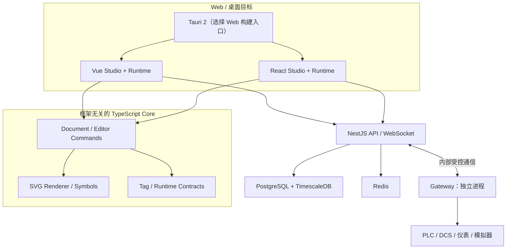
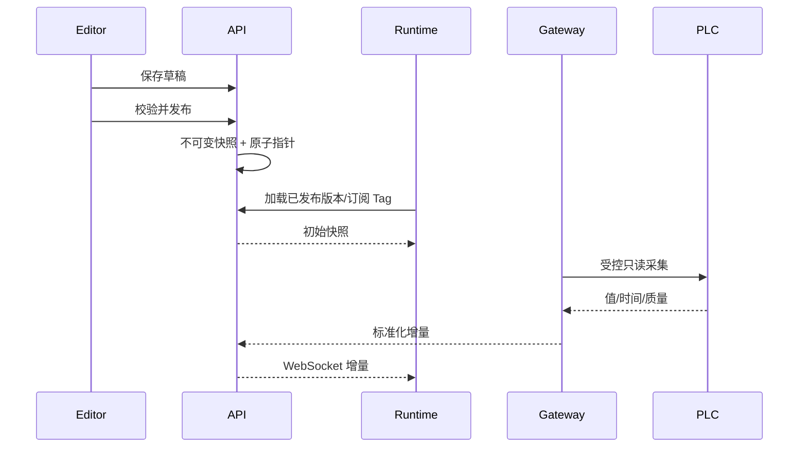

# ADui SCADA · 系统架构（目标设计）

> 2026-11-27 最新决策：维护者已删除旧开发数据库环境，停止历史迁移接管及专用实例实验。后续以 [ADR-0073](adr/0073-prisma8-fresh-install.md) 为准；下文旧实验记录仅供追溯，不是当前验收前置条件。

> **大部分为目标设计。** V0.1 已有共享 Core/Runtime、Vue/React 最小 Web、NestJS 本地进程探针和 Tauri 2 桌面壳；工业 Gateway 尚未创建。实际目录见 [CODEBASE_MAP](CODEBASE_MAP.md)，实现边界见 [V0.1 实施记录](V0.1_IMPLEMENTATION.md)，范围见 [REQUIREMENTS](REQUIREMENTS.md)。

## 1. 架构原则

一份业务事实、一套版本化工程协议、两套 Vue/React 正式 UI；框架无关 Core；编辑与运行分离；独立工业网关；优先安全、可恢复和部署可维护性，不为微服务而拆分微服务。

## 2. 逻辑架构（目标）

Tauri 并非同时运行两种前端；将按构建目标分别选择。Server 处理认证、工程、发布、报警、历史、审计，Gateway 独立管理工业通信。**以上图示不表示相关模块已建成。**

## 3. 选型与状态

| 领域     | 目标方案                                | 现状                                     |
| -------- | --------------------------------------- | ---------------------------------------- |
| 工程     | Vite+ 1.5、pnpm workspace               | 已配置；原锁文件待目标环境复验           |
| Web      | Vue 3、React 19、TypeScript             | 已创建两个最小 Web Runtime               |
| UI       | TDesign React/Vue Next + @adui/theme    | 双框架已使用，主题包待 Windows 验收      |
| 2D       | SVG + 自研独立编辑/渲染核心             | V0.1 只读；V0.2 首批本地 Studio 编辑命令 |
| 共享数据 | Document / TagValue / 质量状态          | V0.1 已实现本地模拟核心，未持久化        |
| 3D       | Three.js 自研 Core + Vue/React adapters | 后续，非 V1 前置                         |
| 桌面     | Tauri 2                                 | 已创建 Windows 优先桌面壳；未验证打包    |
| 业务 API | NestJS                                  | 已创建本地 /health；业务 API 尚未实现    |
| 业务数据 | PostgreSQL + Prisma                     | 候选                                     |
| 历史库   | TimescaleDB                             | 候选；时序迁移独立管理                   |
| 实时     | WebSocket + Redis                       | 候选；V0.1 仅 demo 使用 localhost SSE    |
| 协议     | OPC UA / Modbus TCP / MQTT              | 目标；版本/驱动待 PoC                    |

## 4. 模块与依赖约束

长期目标：`core/document` 管 Schema/迁移；`editor-core` 管命令、撤销重做、几何；`renderer-svg` 管工业矢量图元；`tag-engine` 管类型、质量、快照和增量；`adapter-vue`、`adapter-react` 管框架生命周期及界面。运行时不得反向依赖编辑器；所有核心包不得依赖 Vue/React；前端不能直接连接 PLC。

V0.1 实际使用 `packages/core` 聚合 Document、TagStore、Simulator、SVG 的纯 TypeScript 实现，暂不为尚未稳定的接口建立多个空包。`examples/water-treatment` 是只监听 127.0.0.1 的模拟链路，用于检验工程 Schema、质量和只读可视化，不能直接视为生产 Runtime/API。Vue/React 展示适配已创建；鉴权和工业通信仍是未来工作。

3D 使用独立的 Three.js 引擎抽象，未来经共享设备 ID、Tag ID 与场景协议接入，不要求与 SVG 共享底层 Renderer。

V0.1 的 Tauri 通过默认配置嵌入 React 构建，可通过附加配置选择 Vue。Rust 主程序仅初始化空权限桌面壳，不含工业命令。NestJS Server 与模拟 SSE 服务是两个独立本地进程，当前二者没有业务对接；打包后的桌面应用不内置模拟 SSE。

## 5. 数据与发布流程（目标）

Tag 值保留源时间、接收时间、质量；网络异常触发 STALE/BAD 状态。多个浏览器订阅不能造成重复 PLC 连接。草稿修改不影响发布中画面。这些生产性质尚未通过实际验收。

## 6. 部署、安全与恢复

客户端 HTTPS/WSS → 平台网络 → 受控网关网络 → 现场 PLC；数据库、Redis 不对外开放。OPC UA 证书和访问策略、Modbus 受控网段、MQTT TLS/ACL 按现场要求配置。默认不开放通用写入；重要变更有审计。网关掉线、数据库暂不可用和 WebSocket 重连时，应提供质量与可恢复状态。V1 不声称 HA 或零数据丢失。

V0.1 不建立工业网络连接；模拟服务不可暴露到公网。演示的 SSE 不包含身份/权限模型，不得直接移用于正式运行环境。

## 7. 工具链与共享配置

根 `.editorconfig` 统一格式；`@adui/tsconfig` 提供 React、Vue、NestJS、Node、Core 和浏览器运行时的 TS 基础配置。根 `vite.config.ts` 从 `@adui/tooling` 引入 Format / Lint / Git staged 配置，利用 lint.overrides 应用框架路径规则，避免子应用独立工具配置造成漂移。TSConfig 应用的 include、rootDir、outDir 和 tsBuildInfoFile 保留在各自应用目录，所有第三方版本仍由 pnpm Catalog 控制。

## 8. 风险与 ADR

风险：双框架 UI 维护成本、图元高频渲染、协议兼容、数据量与存储成本、证书、Tauri WebView 差异。性能指标见 [NFR](REQUIREMENTS.md)，待压测后固化。

- [ADR-0001：双框架共享 Core](adr/0001-dual-framework-core.md) — Accepted
- [ADR-0002：网关隔离和只读优先](adr/0002-industrial-io-security.md) — Proposed
- [ADR-0003：pnpm Catalog / TypeScript / Vitest](adr/0003-toolchain-catalog-vitest.md) — Accepted
- [ADR-0004：Web Studio 与 Runtime 合并](adr/0004-unified-web-apps.md) — Accepted
- [ADR-0005：跨框架共享开发配置](adr/0005-shared-toolchain-config.md) — Accepted

重大架构变更应新增 ADR，保留历史决策。

## V0.1 桌面安装版诊断模拟（ADR-0006）

Tauri 2 安装包只嵌入 Web 静态资源，不自动提供 Vite 开发代理或模拟 SSE HTTP 服务。为确保 V0.1 安装后演示可用，Tauri 的 Web 构建指定 `--mode desktop`，从共享 Core 加载水处理 Demo Document 和模拟器，`OfflineDemoRuntime` 在 JS 内存中生成模拟读数并演练 `STALE`，不打开网络连接或 Tauri 特权接口。Web 开发模式继续使用本地 SSE Harness，不能自动切换到离线模式掩盖服务器故障。

数据源状态必须明确标注 `SIMULATION`，用户不能将模拟 `GOOD` 值误认为现场采集质量。正式桌面应用后续应通过具备鉴权与审计的 NestJS/网关服务访问设备，离线历史数据需要另行设计；以上实现仅用于 V0.1 演示验收。[ADR-0006](adr/0006-desktop-offline-simulation.md)。

## V0.1 Docker 本地模拟栈（ADR-0007）

新增 [Docker Compose 演示](../deploy/docker/README.md)，供未来 Docker 化部署演进：React/Vue 两套 Vite+ Web 构建以 Nginx 静态服务分别监听宿主机 `127.0.0.1:8080` 与 `127.0.0.1:8081`；NestJS 健康检查和模拟 Node SSE 仅对容器内部网络开放。Nginx 同源转发 `/demo/project`、`/demo/events`、`/api/health`，不将 HTML fallback 误用为接口响应。

当前是没有鉴权、数据库、生产 API、工业 Gateway 的**演示部署**。不得将此 Compose 暴露到公网/工业现场。生产架构计划独立实现 HTTPS/WSS、网关网络隔离、身份授权、存储与备份。Tauri 桌面发行版继续走 Windows MSI，不进入 Docker Web 部署。见 [ADR-0007](adr/0007-docker-demo-deployment.md)。

## 环境变量与检出换行符（ADR-0010）

ADR-0008 的分散模板方案已被 [ADR-0010](adr/0010-root-env-lf.md) 取代。Vue/React Vite+ 配置通过同一个仓库根 `envDir` 加载 `SCADA_*`；Node 进程读取根 `.env`；Docker Compose 从工作目录根 `.env` 注入 Web 宿主机端口和容器内部服务端口，Nginx 在启动时把内部端口写入代理模板。容器仍只发布 loopback Web 端口，服务端/模拟器不对宿主机公开。

根 `.gitattributes` 将文本检出规范为 LF，与 `.editorconfig` / Oxfmt 一致，减少 Windows 上 Git CRLF ↔ Oxfmt LF 的反复变更。设备、真实网关、生产凭据和控制写入未引入。

## V0.2 Studio 第一阶段：编辑与运行隔离（ADR-0009）

`packages/core/src/editor.ts` 以单独 `@adui/scada-core/editor` 子路径导出框架无关 Editor API。Vue/React 各自拥有 `src/studio/StudioPage`，App 入口按需加载 Studio 与 Runtime；Runtime 代码不 import Editor 入口。工程继续使用原有 `ScadaDocument`、`renderSvgPage` 与 Tag ID，不更改 Schema 版本，也不新增 Workspace 包或依赖。

编辑命令本地不可变、校验、最多 100 步撤销历史；JSON 导入/导出只是本地草稿。服务端工程 CRUD、发布版本与真实工业运行仍未实现，不能把 Studio 的导出等同于安全发布。见 [ADR-0009](adr/0009-studio-editor-foundation.md)。

## V0.2 Studio 第二批：共享编辑命令语义（ADR-0011）

仍沿用独立 `@adui/scada-core/editor` 子入口，增加多选、节点增删、批量平移、对齐、图层排序与可逆命令；React/Vue 分别承担指针交互和 UI，视图缩放不会污染共享 Schema。所有新增图元的 `bindings` 均为空，不能借编辑器操作接入真实 PLC/DCS；Runtime 不依赖 Editor。

设计细则与取舍见 [ADR-0011](adr/0011-editor-canvas-operations.md)。

## V0.2 画布网格与吸附几何（ADR-0012）

共享 Core 的 `snap.ts` 负责可重复的网格/图元参考线吸附计算；React/Vue 分别呈现纯视图网格与辅助线，并使用相同位移结果调用共享的编辑命令。此能力不引入框架依赖、第三方包或新 Schema 字段；Runtime、模拟数据与工业安全边界不变。详见 [ADR-0012](adr/0012-grid-snap-guides.md)。

## V0.2 图元属性编辑命令（ADR-0013）

图元几何属性 `x/y/width/height/rotation` 的校验、原子提交与撤销由框架无关 `@adui/scada-core/editor` 统一负责；React 和 Vue 仅采集本地数值表单输入并显示结果。继续使用 `ScadaDocument 0.1.0` 与现有渲染器，不新增依赖、页面状态或设备写入接口。具体约束见 [ADR-0013](adr/0013-node-transform-properties.md)。

## V0.2 SVG 缩放与旋转控制手柄（ADR-0014）

Vue/React 的 SVG 编辑层负责显示控制点、捕获 Pointer 和提供预览；`@adui/scada-core/editor` 内独立的 `transform-gesture.ts` 负责旋转坐标换算、对角锚点固定及角度吸附。所有预览/最终提交由现有 `withNodeTransform` / `DocumentEditor.updateSelectedTransform` 校验与入历史，Runtime 不引入手柄逻辑。工程 JSON 契约和工业安全边界不变。[ADR-0014](adr/0014-svg-transform-handles.md)。

## V0.2 八方向缩放与旋转锚点（ADR-0015）

`@adui/scada-core/editor` 的 `transform-gesture.ts` 统一计算八方向局部手柄位置、中文名称、单轴或双轴尺寸变换与旋转锚点；Vue/React 仅承载 SVG 交互视图，继续调用原 `withNodeTransform` 和编辑器撤销命令。相对前一批只扩展共享纯函数与两套手柄展示，不增加第三方依赖或 Schema 字段。详细取舍参见 [ADR-0015](adr/0015-eight-direction-resize.md)。

## V0.2 Shift 等比例缩放（ADR-0016）

沿用框架无关 `@adui/scada-core/editor` 下的 `transform-gesture.ts` 计算。通过向 `resolveResizeTransform` 增加默认关闭的锁比例参数实现等比例变形，Vue/React 仅转交 Pointer 事件中的 `shiftKey` 并展示 SVG 手柄提示。保持 `withNodeTransform` 校验、原子历史、共享 JSON Schema、Tag 绑定和 Runtime 边界不变。详见 [ADR-0016](adr/0016-aspect-ratio-resize.md)。

## V0.2 平面图元组合（ADR-0017）

为减少对已有 SVG Core 与 Runtime 的影响，在共享 `ScadaNode` 加入**可选逻辑组合 ID**，仍保留节点的平面结构及绘制顺序。`packages/core/src/grouping.ts` 只为 Editor 的移动、选中和吸附计算提供共享组员扩展；Vue/React 只负责选择、组合/解组按钮与中文状态展示。组合元数据的输入验证集中在现有 `parseScadaDocument`，原编辑历史保持最多 100 次。此版本不引入新 npm 依赖、不增加工业控制接口，跨版本数据语义与风险见 [ADR-0017](adr/0017-node-grouping.md)。

## V0.2 Schema 版本校验与迁移边界（ADR-0018）

`@adui/scada-core` 的文档层区分 **当前版本校验** `parseScadaDocument` 与 **历史导入** `migrateScadaDocument`。共享 Editor、SVG 和 Runtime 只解析 `0.2.0`；仅 Studio 本地导入通过 `DocumentEditor.loadDocument` 调用历史迁移。对未知版本与不支持的结构字段明确拒绝，避免旧客户端重新保存时静默丢失 `groupId`；Vue/React 使用统一迁移结果和提示。保持共享 Core 无框架依赖、Runtime 不依赖 Editor、工业设备只读边界。详见 [ADR-0018](adr/0018-schema-version-migration.md)。

## V0.2 本地草稿持久化与恢复（ADR-0019）

共享 `packages/core/src/local-draft.ts` 只依赖已验证的 `ScadaDocument 0.2.0` 和注入式 `LocalDraftStorage` 接口，不直接依赖 DOM 或前端框架。Vue/React Studio 分别适配 `window.localStorage`，提供同样的手动保存、恢复和清除入口。记录按 `projectId` 与浏览器 Origin 隔离；恢复操作先验证记录，再调用 `DocumentEditor.loadDocument` 完成原子替换。只读 Runtime、NestJS 和工业网关均不依赖本地草稿。浏览器本地草稿不是加密存储或正式工程备份，见 [ADR-0019](adr/0019-local-draft-persistence.md)。

## V0.2 本地草稿按需自动保存（ADR-0020）

继续使用 `@adui/scada-core` 的共享 `LocalDraftStorage`/Schema 校验，在 `local-draft.ts` 封装框架无关的 `LocalDraftAutoSaveSession`：工程内容脏状态判定、原始存储记录比对与拒绝冲突覆盖。Vue/React 各自用生命周期实现相同的 1000 ms 延迟写入、显式开启/暂停与浏览器 `storage` 事件停写。恢复仍显式确认，`Runtime`、NestJS、工业网关及设备写入完全不参与。浏览器无法提供原子多标签页事务，属于尽力冲突检测而非严格排他锁。详见 [ADR-0020](adr/0020-safe-local-autosave.md)。

## V0.2 浏览器工程 IndexedDB 事务仓储（ADR-0021）

在 Core 的框架无关编辑器与真实浏览器之间加入 `@adui/scada-draft-storage`，由 `DexieDraftRepository` 独占浏览器数据库适配与迁移，底层采用 IndexedDB、Dexie.js 和单事务修订号比较。Core 新增仅含 TypeScript 的 `DraftRepository` / `DraftAutoSaveSession` 异步接口，Vue 和 React 都消费该契约，跨框架不复制数据库规则。旧 `localStorage` 仅作一次性历史数据迁移来源。通过 `BroadcastChannel` 加速同 Origin 标签页状态通知，版本一致性由数据库事务负责。工业只读 Runtime、NestJS、Gateway 和工程发布边界不变。参考 [ADR-0021](adr/0021-indexeddb-dexie-storage.md)。

## V0.2 多页面 Studio 编辑作用域（ADR-0022）

共享 Core 负责当前页面会话状态、页面编辑命令与历史上下文。框架适配层只实现页面导航与指针生命周期，不复制文档规则；拖动吸附与 SVG 预览通过可选 `pageId` 明确作用于当前页，旧单页面调用默认第一页兼容。工程 JSON/IndexedDB 仍保存整份 `ScadaDocument 0.2.0`，不包含 `activePageId`；页面切换不产生保存写入。新增页面、重命名和删除按现有自动保存流程提交，删除最后一页被拒绝。详见 [ADR-0022](adr/0022-multi-page-editor-scope.md)。

## V0.2 页面复制与工程 ID 命名空间（ADR-0023）

页面复制和跨页选中图元复制由框架无关 `DocumentEditor` 统一执行：页面、图元、组合共享全工程唯一 ID 空间，新副本重映射 ID 并保留 Tag 绑定及组内关系。页面排序直接修改 `ScadaDocument.pages` 顺序，因此现有 Runtime 的默认第一页展示也会改变；不另设启动页，也不变更 Schema `0.2.0`。在目标画布较小时，跨页复制整体平移以保留相对布局，无法容纳则原子拒绝。Vue/React 仅提供导航与操作入口，Dexie IndexedDB 继续使用既有整工程版本事务，不涉及真实设备写入。详见 [ADR-0023](adr/0023-page-copy-and-reordering.md)。

## V0.2 会话图元剪贴板（ADR-0024）

剪贴板状态仅由共享 `DocumentEditor` 管理，包含从受校验工程复制的节点与成功粘贴计数。Vue/React 只适配工作区按钮和快捷键，不读写系统剪贴板、没有新的外部依赖。粘贴复用现有全工程唯一 ID、组映射和 Parser 原子校验，允许不同页面复用但禁止导入新工程后残留旧剪贴板。只有剪切和粘贴改变文档并进入撤销历史及既有 Dexie 草稿机制；纯复制、页面切换、剪贴板快照不进入工程 Schema `0.2.0`。工业只读数据通路保持原状。详见 [ADR-0024](adr/0024-session-node-clipboard.md)。

## V0.2 图元锁定与可见性（ADR-0025）

图元锁定与隐藏语义统一在框架无关 SCADA Core 及 SVG Runtime。为避免在 `ScadaDocument 0.2.0` 增加会被旧版严格白名单拒绝的新顶层字段，使用 `props.__scadaStudio` 中经校验的 `locked`、`visible` 可选布尔值；Vue/React 只负责批量命令 UI、图层状态标记及画布手势适配。编辑命令与提交边界共同阻止锁定图元的误修改，Runtime 只渲染可见节点，不改变 Tag 数据质量或工业只读链路。**旧 Runtime 不解释隐藏状态**，后续发布链必须校验运行端能力，不可将此批视为正式版本协商。详见 [ADR-0025](adr/0025-node-lock-visibility.md)。

## V0.2 精确图层排序与组合连续性（ADR-0026）

继续保持 `ScadaDocument 0.2.0` 中每页 `nodes[]` 为唯一 SVG 图层顺序来源，后项覆盖前项；不维护独立 `zIndex`。共享 `DocumentEditor.moveLayer` 按目标图元/组合边界插入原始节点，源组移动时完整连续搬运，中央 Core 检查锁定图元原始索引不受其他图元移动影响。React/Vue 仅负责逆序列表、HTML5 拖放位置和可访问的精确选择操作；未采用第三方拖拽库，也不解析外部拖拽数据。变更沿用 JSON、撤销历史和 Dexie 草稿，Runtime 只读语义不变。详见 [ADR-0026](adr/0026-precise-layer-order.md)。

## V0.2 组合图层树投影（ADR-0027）

为保持共享 `ScadaDocument 0.2.0` 的扁平图层与 `groupId` 契约，树形图层面板采用框架无关 `buildLayerTree` 纯函数进行**只读投影**，不引入新的组实体、嵌套组关系或 Runtime 依赖。投影按 `nodes[]` 的真实绘制层序生成组标题与成员、统一搜索过滤及锁定/隐藏统计，并明确标记历史非连续组合。Vue/React 分别维护折叠/搜索/定位会话状态，点击组和成员仍调用 `DocumentEditor.select`，拖拽仍调用 `moveLayer`，保持权限边界及撤销历史一致。JSON 与 Dexie IndexedDB 草稿不持久化这类 UI 视图状态；只读 Runtime 与生产设备写入安全约束不变。参见 [ADR-0027](adr/0027-layer-group-tree-projection.md)。

## V0.2 双框架 TDesign UI 技术选型（ADR-0028）

根据维护者 2026-11-11 的明确决策，React 与 Vue 3 Web Studio 均采用腾讯 TDesign：React 为 `tdesign-react` / `tdesign-icons-react`，Vue 为 `tdesign-vue-next` / `tdesign-icons-vue-next`。根 pnpm Catalog 统一固定依赖版本，Studio 按需导入组件与官方样式。框架相关 UI 状态不进入 Core 或 Runtime：共享 `GEOMETRY_PROPERTY_FIELDS`、`DocumentEditor`、ScadaDocument `0.2.0` 和 Dexie IndexedDB 草稿协议均保持框架无关。迁移从 Studio 属性面板和图层搜索开始，旧原生表单按批次替换，不引入 Ant Design，也不把 TDesign 视为工业设备数据或权限的来源。详见 [ADR-0028](adr/0028-tdesign-dual-framework-ui.md)。

## V0.3 第二批：共享工程快照基础（ADR-0035）

`@adui/scada-core` 新增框架无关 `project-snapshot.ts`，仅依赖现有 `ScadaDocument 0.2.0` Parser 与运行环境原生 WebCrypto。它提供结构校验结果、SHA-256 完整性摘要、带元数据的深冻结工程快照和严格回读；不依赖 Vue、React、NestJS、Dexie 或浏览器 DOM API。应用、存储、版本指针、身份权限与工业协议均不得进入 Core；后续发布服务必须独立解决并发、审计、存储事务和运行时版本切换。本批仍为离线能力，详见 [ADR-0035](adr/0035-project-validation-snapshot.md)。

## V0.3 第三批：浏览器本地历史仓储（ADR-0036）

共享 Core 仅声明 `ProjectVersionRepository` 和历史摘要，WebCrypto SHA-256 快照继续复用现有 `project-snapshot.ts`。独立 `@adui/scada-draft-storage` 的 Dexie 适配提供浏览器同 Origin 内追加历史版本、事务 CAS 修订号及倒序分页。历史库 `adui-scada-studio-versions` 与已存在的草稿库 `adui-scada-studio` 分开，不改变任何已有数据库迁移。未来 PostgreSQL/NestJS 版本仓储应单独实现权限及审计；浏览器 head 不属于正式已发布版本指针，不能连接工业生产 Runtime。详见 [ADR-0036](adr/0036-local-version-history.md)。

## V0.3 第四批：双框架版本历史管理 UI（ADR-0037）

Vue/React Studio 通过共同的 `@adui/scada-core` 比较契约、`@adui/scada-draft-storage` 独立历史仓储访问各自浏览器 Origin 的本地版本，样式统一在 `@adui/tailwind/studio.css`。用户确认后调用现有编辑器载入入口，不接入 Runtime 发布指针、服务端 API、工业网关或设备写入。浏览器历史不保证跨 Origin/跨设备共享，正式工程仓储仍需服务端权限及事务设计。

## V0.3 第五批：本地历史恢复可靠性（ADR-0038）

继续复用 `DraftAutoSaveSession` 的队列化异步写入与 `stop()` 停写承诺，双框架只通过现有操作门闩防止 JSON 导入和历史恢复并发修改。安全回归在隔离 Chrome/Edge profile 内使用实际 IndexedDB，覆盖撤销确认、历史持久化、Origin 隔离和模拟 IndexedDB 拒绝打开。未修改共享 Schema、Runtime、数据库结构或工业服务；这仍是浏览器本地一致性保障，不是服务端发布事务或工业安全认证。

## V0.3 第八批：受控服务端持久化边界（ADR-0040）

共享 Core 新增无框架依赖的 `parseServerProjectSaveRequest` 作为**纯请求结构校验**，供未来 NestJS 服务复用；该函数不负责认证、授权、CAS、审计或写入。未来服务端调用顺序必须是：认证（可信主体）→ 工程级授权 → 请求体与 Schema 校验 → 数据库事务内修订号 CAS → 生成不可变快照与持久化 → 审计。未确定服务端信任模型、数据库和访问策略前，**NestJS 不注册工程保存、发布或回滚路由**；不改变只读工业边界。

## V0.3 第九批：服务端工程权限与事务仓储候选设计（ADR-0041）

候选 PostgreSQL 存储按 `(tenant_id, project_id)` 复合主键隔离工程，服务端维护工程 head 修订号、只追加版本快照、逐权限授权记录与提交成功的审计事件。写入事务必须对工程行加锁、以客户端 `expectedRevision` 对比真实 head，写入版本、更新 head 和审计记录在**同一事务**提交或全部回滚；撤销工程授权的流程也必须锁同一工程行，避免授权撤销与保存交叉执行。

`apps/server/src/projects/project-access-policy.ts` 仅提供 NestJS 侧无副作用、默认拒绝的权限判定，不属于 Core 或可对外调用的认证服务。正式生产读写路径必须接入可信身份、工程 ACL 查询、受控数据源和持久审计；在这些能力交付之前继续只注册 `GET /health`，不新增 `/api/projects` 或工业写入路由。

## V0.3 第十批：PostgreSQL + Prisma 7 持久化基础（ADR-0042）

按用户确认采用 PostgreSQL + Prisma ORM，**不是 Prisma Postgres 云数据库**。Prisma 7 CLI、Client、`@prisma/adapter-pg` 统一通过根 pnpm Catalog 锁定，Schema 和 Migrate 配置仅位于 NestJS 服务端；生成客户端在 `apps/server/src/generated/prisma`，不进入共享 Core、Vue 或 React。根 `.env` 配置数据库连接，默认 NestJS 不初始化数据库连接且 `/health` 不被误用为数据库健康验证。

ADR-0041 的工程/ACL/版本/审计复合隔离模型转为首次迁移草案，包含不能由 Prisma Schema 单独表达的 PostgreSQL CHECK 约束。独立本地开发 PostgreSQL 可用 Docker Compose 启动，迁移验证应在隔离实例完成；在可信身份、授权 Guard、PrismaService、事务仓储和完整审计实现前，工程版本读写接口继续保持 404。

## V0.3 第十一批：Prisma 7 工程事务仓储（ADR-0043）

NestJS 服务端增加 `PrismaService`（应用生命周期内单实例 Client + 现有 `@prisma/adapter-pg`）及 `PrismaProjectVersionStore`，以隔离 `ProjectPersistenceModule` 提供受控读写能力；**不导入现有 AppModule**，进程健康接口保持不依赖 PostgreSQL。共享 Core 继续负责请求 Schema 和版本 SHA-256 校验，客户端 Vue/React 不引入 Prisma。

仓储在 PostgreSQL 事务内通过参数化 `$queryRaw` 获取工程行锁并复查 ACL；版本新增、head 和成功审计属于一个 Prisma Interactive Transaction，失败由 Prisma 自动回滚。真实并发竞争、跨租户访问等另设专用本地测试数据库，不默认纳入 `ready`。未上线可信认证或工程级 Guard 前，严禁注册工程版本 HTTP 路由。

服务端 Docker 运行镜像需随工作区依赖一并复制 `packages/core` 的包清单和源码，才能让 Node 24 从编译后的 NestJS 模块按工作区导出加载共享 Core；本批补齐该依赖，仍不导入工程写入控制器。

### PostgreSQL 中文元数据注释规范

Prisma `schema.prisma` 的 `///` 为代码生成文档信息，**不会自动创建 PostgreSQL 的表/字段注释**。依据仓库 `postgresql-table-design` Skill，现以增量 Prisma Migration 的 `COMMENT ON TABLE/COLUMN/INDEX` 为数据库注释权威来源；对已应用的初始建表迁移不做历史修改。四张业务表、23 个物理字段及四个业务索引均补充中文说明；Prisma 自管理的 `_prisma_migrations` 不受业务注释规则约束。后续增表需在同批迁移中同步注释，静态测试与独立数据库查询负责验收。

### 第十一批补充：Core 双消费端条件导出及 NestJS TypeScript 兼容

维护者 Windows `pnpm run ready` 在服务端 `tsc --noEmit` 遇到 Core 源码的 23 处 `TS5097`。原因是 Core 源码直接导出 `*.ts`（适用于 Core/浏览器的 `allowImportingTsExtensions`），但 NestJS 使用 `NodeNext` 且当前包入口直接指向工作区外的源码。不能简单修改 Core 全部导入后缀或只给 NestJS 开启 `allowImportingTsExtensions`：后者会在实际带输出的构建中遇到工作区 `rootDir` 边界问题。

本批让 **Core 的 Node 条件导出指向预先生成的 `dist/*.js` 与 `dist/*.d.ts`**，前端默认导出仍是原 `src/*.ts`。Core 使用 TypeScript 6 的 `rewriteRelativeImportExtensions` 生成真实 ESM 文件，不添加第三方依赖或改变共享 Schema；NestJS 在类型检查、编译和 Docker 运行层只引用 Core Node 产物。服务端、Core 和前端保持同一业务逻辑源文件，只是平台输出不同。

## V0.3 第十二批：真实 PostgreSQL 回滚与容器隔离烟测（ADR-0044）

继续复用已合并的 `ProjectPersistenceModule` 与 `PrismaProjectVersionStore`，本批不改变其正式对外接口和 Prisma 数据库模型。测试通过 Prisma 查询扩展**只对测试客户端**将审计 `action` 改为非法值，触发 PostgreSQL 已存在的 CHECK 约束；此前写入的版本和修订号必须由同一 Interactive Transaction 真正回滚。授权并发测试让管理侧事务先 `FOR UPDATE` 锁工程行、撤销授权，再校验等待保存因重新查询权限而失败。管理侧锁顺序只是未来授权服务的规范，本批不新增可用的授权管理 API。

服务端镜像回归采用独立 `docker build` 与 `docker run --network none`，不开放宿主端口；容器内部使用临时回环端口验证 `/health` 返回值、Core/仓储模块可加载及未实现工程/工业写入路由保持 404。Docker 构建上下文遵守现有 `.dockerignore`，排除根 `.env`、密钥及本地凭据。Docker 构建需要本地镜像源，故不默认纳入普通 `ready`。

## V0.3 第十三批：可信身份与工程 Guard 基础（ADR-0045）

为本地/私有化场景建立短期**可撤销不透明会话**，暂不依赖 JWT 自发行或临时模拟登录：`scada_identities` 记录租户内主体与 active/disabled 状态，`scada_auth_sessions` 仅存储不可逆 SHA-256 高熵令牌摘要、到期/撤销时间及 UUID 会话主键。32 字节令牌使用 Node 原生密码安全随机源生成，明文只在内部签发时返回一次；每次 HTTP 请求查 PostgreSQL 以便即时拒绝撤销/停用。

`ScadaSessionGuard` 从唯一的 Authorization Bearer 请求头解析令牌并恢复服务端主体；`ScadaProjectGuard` 按请求路由的 `projectId` 和**已验证主体的 `tenantId`** 查询现有 `scada_project_grants`，复用 `hasProjectPermission` 严格授权，拒绝无元数据/跨租户/无权限。组合装饰器确保未来路由先认证后授权；事务写入仍必须在 `PrismaProjectVersionStore` 的工程行锁内再次复查 ACL，Guard 不替代锁内校验。当前所有模块**不挂载 AppModule**，无新业务端点。

日志、Swagger、JWT/OIDC、密码散列、Nano ID、限流依赖按 [依赖选型](DEPENDENCY_SELECTION.md) 阶段化引入，先选最小可信基础，不让未经安装/实测的第三方依赖影响现有质量链。

## V0.3 第十四批：日志与 HTTP 安全入口（ADR-0046）

本批在现有 NestJS 12 `AppModule` 引入 `LoggerModule.forRoot`，统一将 Nest 内部日志与 `pino-http` 关联，并在 `main.ts` 将 `nestjs-pino` Logger 设置为应用日志入口。`http-logging.config.ts` 约束可配置日志等级、由服务端生成 `x-request-id`，并使用白名单请求/响应序列化和 Pino 敏感字段遮蔽，避免把 `Authorization`、Cookie、查询参数、请求体或密码写进结构化日志。D5b8g 候选进一步在已有 `pino-http` 失败日志的 `err` 字段使用固定 `{ type: "HTTP_ERROR" }` 安全序列化，不读取原始 Error 消息、堆栈、cause 或额外属性；请求 ID、HTTP 方法和响应状态码仍可用于关联诊断。该约束不改变异常过滤器和正式发布 fail-closed 行为，也不等于其他应用日志已全部完成敏感数据审计。

`http-security.ts` 默认启用 Helmet。文档入口使用 `allowLocalOpenApi` 执行显式开关 + 非生产 + 127.0.0.1 三重限制，不满足时**不加载 Swagger、也不注册文档路由**；开发本机有 Swagger UI 时局部调整 CSP，生产默认 Helmet 全部安全头。`/health` 通过 Swagger Decorator 声明只代表进程存活，未挂载 `ScadaIdentityModule` 或 `ProjectPersistenceModule`，不改变工业只读安全边界。

第十四批相关依赖已由维护者 Windows pnpm 12 正式生成锁文件并完成完整质量链及 Docker 隔离烟测，现已合并至 main。

## V0.3 第十五批：NestJS 启动环境加载顺序（ADR-0047）

根 `.env` 的本地加载入口仍是 `apps/server/src/main.ts`，并继续由宿主/容器进程环境变量承担部署覆盖。为了避免 `AppModule` 在模块求值期间构造 Pino 配置时过早读取 `SCADA_LOG_LEVEL`，正式入口改为在 `loadEnvFile` 完成后动态导入 `AppModule`。纯函数 `resolveServerStartupConfig` 集中读取和校验端口、监听地址及复用受控 OpenAPI 策略，保留已发布默认值与白名单，不暴露敏感配置。该纯模块不连接数据库、不加载工业网关、不注册业务路由。模块化类型配置注入和全部生产部署变量的 Schema 化校验仍待后续专项推进。

## V0.3 第十六批：安全事件审计边界（ADR-0048）

在未挂载 `AppModule` 的 `ScadaIdentityModule` 中注册独立 `ScadaSecurityAuditService`，并通过 `SecurityAuditReporter` 接口及 NestJS 注入令牌供 `ScadaSessionGuard` 和 `ScadaProjectGuard` 使用。Guard 记录允许/拒绝决策，但不发送请求头、令牌、路径、租户/主体/工程标识或异常对象；日志层对枚举做运行时白名单检查并只构造固定四字段对象。现阶段借助 NestJS Logger 与已经引入的 Pino 运行日志链输出，**仅用于诊断而非生产持久化审计**。未增加外部依赖、数据库迁移、HTTP 路由或工业写入能力；未来必须在上线身份 API 前独立评审可信主体关联、持久化审计、丢失处理、保留/删除及限流。

## V0.3 第十七批：NestJS 12 原生 Standard Schema 与 Zod（ADR-0049）

服务端根 `.env` 加载流程及 `AppModule` 动态导入时序不变。运行时端口和监听地址由 `zod@4.6.7` 校验，优先级与错误提示不变；仅 `undefined` 属于未配置，非法 `null` 不得回退为默认监听参数。

NestJS 12 自带 `StandardSchemaValidationPipe`、`StandardSchemaSerializerInterceptor`，Swagger 12 原生识别 Zod 4 Standard JSON Schema。维护者 Windows 实测发现此前选用的 `nest-zod@2.1.0` 的 Swagger `ZSerialize` 适配器在模块装饰器求值时失败，且上游 Peer 不包含 NestJS 12 / Swagger 12，因此撤销该依赖，复用已有 NestJS 原生设施。独立测试 Controller 验证请求体、查询转换、响应白名单和 OpenAPI；不在正式 AppModule 注册新业务路由、全局 Pipe 或 Serializer。

Zod 不进入共享 Core，也不改组态工程/Tag/图元 Schema、Prisma、工业网关、Guard 或安全审计。上一次包含 `nest-zod` 的锁文件须由 pnpm 重算；新代码、类型与 Docker 安全边界尚待 Windows 完整复验。

## V0.3 第十八批：HTTP 就绪与可运维边界（ADR-0050）

新增 NestJS 官方 `@nestjs/terminus@12.1.0`，其已核对发行包 Peer 支持 NestJS 12 / Swagger 12 / Node 24。正式 `AppModule` 只增加 `TerminusModule`、`HttpReadinessController` 和 `HttpReadinessIndicator`，保留现有 `/health` 存活接口；`/health/ready` 使用应用生命周期与 Terminus `HealthCheckService` 表示 HTTP 子系统的启动/关闭状态，未就绪时返回 503、禁止缓存。结果固定标记外部依赖 `not_checked`。

现阶段独立 Prisma 工程仓储和工业网关均未挂入正式 HTTP 模块，**不允许因为接入 Terminus 而隐式启用数据库连接或设备采集**。未来业务就绪检查必须单独定义依赖、超时与失败策略；登录/API 限流等真实受保护路由上线前再引入 `@nestjs/throttler` 和必要的多实例共享配额，不对探针应用通用限流。

## V0.3 第十九批：HTTP 资源边界与关闭入口安全（ADR-0051）

NestJS 12.0.3 Express 适配器本身支持 `return503OnClosing`；与已有 `app.enableShutdownHooks()` 组合后，在关闭流程一开始就拒绝新到 HTTP 请求，避免新请求继续进入即将停止的模块。该能力不配置强制断连，也不代表可以保障所有长连接或工业网关事务的生产级排空。

Node 24 原生 HTTP Server 在 `app.listen` 之前由 `apps/server/src/security/http-server-policy.ts` 统一配置有限的头/请求接收时限、Keep-Alive 空闲时限及请求数量限制。**只约束传入请求接收，不限制响应时长**，避免损坏规划中的长期 SSE 订阅。生产与隔离测试均使用同一配置常量，不增加依赖、环境变量、数据库连接或业务路由。未来反向代理、WebSocket/SSE 排空、多实例流量摘除与强制停止上限应独立评审。

## V0.3 第二十批：Linux 容器关闭信号与运维退出语义（ADR-0052）

正式 NestJS 应用从 `enableShutdownHooks()` 切换为 NestJS 12 自带的 `enableShutdownHooks([], { useProcessExit: true })`。根据上游 12.0.3 源码，默认完成关闭后重发信号可能使 SIGTERM 退出码为 143；选择在关闭钩子完成后主动正常退出（0），便于隔离容器验证，并为同步 JSON Pino 日志提供明确退出生命周期。该选项会改变 Unix 退出码语义且可能影响未来其它信号监听器，正式运维接入时须复审。

不增加应用路由、持久化连接或网关实例。Docker 测试继续以 `--network none` 隔离正式服务进程，容器内部回环验证就绪，发送真实 Linux SIGTERM 并检查正常退出。该能力不代表已完成负载均衡摘流、SSE/WS 长连接排空和工业网关状态恢复。参见 [ADR-0052](adr/0052-linux-sigterm-container-shutdown.md)。

## V0.3 第二十一批：本机模拟 Tag 接入 NestJS（ADR-0053）

新增独立的 `LocalDemoTelemetryModule`，内部使用框架无关 `@adui/scada-core` 的 `TagStore`、`WaterTreatmentSimulator`、共享模拟工程。正式 `AppModule` 不注册演示路由；`LocalDemoAppModule` 仅在启动配置同时满足显式启用、非生产、回环监听时组合正式模块与模拟模块。NestJS 原生 `@Sse` 携带相同 `TagChange` 快照及增量协议，RxJS 取消订阅时移除事件监听器，模块销毁时清理模拟定时器。

该数据源仅生成三个固定水处理模拟 Tag，不访问 PLC、工业网关、Redis 或 PostgreSQL。既有独立 `/demo` 代理与 Vue/React Runtime 不改动；将来真实工业 Tag 服务须另行定义受信身份、Tag ACL、连接配额、断线重同步及网关安全通信，不能直接将此开发模块部署为生产入口。

## V0.3 第二十二批：框架无关 Runtime 数据源接口

`packages/runtime/src/tag-source.ts` 是只读数据源的浏览器传输适配边界：加载未知工程 JSON（由 Core 严格校验）、订阅未知实时事件（交由 `applyDemoChange` 和 TagStore 统一校验）、返回只读取消订阅句柄。固定同源 SSE 工厂只允许 `standalone` 的 `/demo/*` 和 `nest-local` 的 `/api/dev/demo/*`；不接受外部 URL、网关/PLC 地址或设备写入方法。

Vue/React 两套 Web 仍用共享 `DemoRuntime` 默认预设，没有新增环境开关、路由代理或生产业务接口。Nest 开发模拟模块及 Swagger 非生产回环访问限制保持原样；如果未来希望从浏览器切换到 Nest，本地同源路由映射和部署访问边界必须单独评审，不得直接跨域连接或暴露无鉴权诊断接口。Tauri 离线模拟维持现状。

Runtime 生命周期按连接代次隔离：停止时中止 fetch、关闭 SSE、旧值标记 STALE，断线后等待新 snapshot 才恢复接收 delta；有害消息关闭当前订阅。此基础不涵盖正式鉴权、工业采集、发布版本加载、背压与多客户端在线容量。详见 [ADR-0054](adr/0054-readonly-tag-source-adapters.md)。

## V0.3 第二十三批：模拟 SSE 心跳和 Tag 数据双时钟

本机独立水处理 HTTP SSE 与显式开启的 NestJS 本机模拟 SSE 均增加每 5 秒一个 `event: heartbeat` 具名事件，保持共享 `TagChange` 的 `snapshot/delta` 结构不变，事件不承载工业设备读数。浏览器 `createSseTagSource` 独立维护 15 秒传输空闲看门狗：收到 Tag 事件或具名 heartbeat 即重置，超时后只重建原固定同源 EventSource，旧流回调失效，订阅关闭时释放定时器。

`DemoRuntime` 独立维护 12 秒有效 Tag 值接收看门狗：只有经过共享 Core 校验且有值的 TagChange 能刷新数据新鲜度；持续停止更新时借助 `TagStore.markDisconnected` 将旧读数标记 STALE，`RuntimeStatus.stale` 与中文显示名称为 Vue/React 共用。网络报错继续显示 reconnecting 并等待新的 snapshot；Heartbeat 不向 TagStore 注入假读数。两套看门狗都需要在停止、非法事件和断连切换中清理/屏蔽旧会话；本机原有 8 秒停采样演练不应触发 12 秒误判。见 [ADR-0055](adr/0055-sse-heartbeat-and-tag-silence.md)。

以上均为模拟链路原型，不代表经过现场评审的心跳 SLA、认证的 Gateway、生产 SSE 背压、工控网络部署或真实设备质量处理。

## 2026-11-13 · V0.3 第二十四批：浏览器 SSE 时效回归

浏览器仍经 React/Vue 两个正式 Web 入口、共享 Runtime 和现有同源开发代理访问本地模拟 SSE。后台页可见性恢复复查由共享 Runtime/TagSource 实现，避免双框架重复实现或额外的工业协议入口；测试使用真实浏览器的原生 EventSource 包装层，保留前后端实际 HTTP/SSE 路径。故障注入局限于浏览器回调层，不视为网络或工业网关可靠性测试。详见 [ADR-0056](adr/0056-sse-browser-visibility-recovery.md)。

## 2026-11-13 · V0.3 第二十五批本机 SSE 容量保护

只读开发演示拓扑保持“浏览器 Vue/React → 固定同源 Nginx/Vite 代理 → Node 独立模拟 SSE”。仅在 `examples/water-treatment/sse-clients.mjs` 为 Node 模拟器加入内存连接管理，32 路连接上限、每路 64 KiB 待发送缓冲上限及背压快速断开。客户端重新连接必须重新获取 snapshot，服务不维护离线消息队列。新 `test-runtime-sse-network.mjs` 的直连和 Docker 模式只访问 loopback；不修改 NestJS 正式模块、工业网关与数据库。见 [ADR-0057](adr/0057-local-sse-capacity-and-proxy-validation.md)。

## 2026-11-13 · V0.3 第二十六批：回环 TCP SSE 故障代理仅位于测试工具链

在现有 Vue/React → Vite 或 Docker Nginx → 独立 Demo 只读 SSE 链路外，增加独立 Node TCP 回环透明代理作为浏览器自动化的临时入口。代理只识别固定 `GET /demo/events` 或 `GET /events` 的会话，允许对单路下行字节进行暂停，且不向用户应用、工业 Gateway、NestJS、Core 或 Docker 正式配置注入网络控制 API。原有浏览器测试缺省入口和固定同源 `/demo` 路径均保持不变。可选六路长连接持续观测直接复用既有 Node SSE HTTP 脚本；见 [ADR-0058](adr/0058-tcp-sse-fault-and-soak-tests.md)。

## 2026-11-13 · V0.3 第二十七批：框架无关的只读诊断

共享 `@adui/scada-runtime` 新增纯诊断构建器和类型，用于将单个 Runtime 会话中的 TagStore 接受事件与可见值分布转换为不可直接修改数据源的状态快照。Vue 与 React 通过各自响应式生命周期消费同一 `RuntimeState.diagnostics`，共用 `runtime.css` 的网格布局；Tauri 离线模拟由现有 OfflineDemoRuntime 构造相同快照。没有外部日志采集器、HTTP 诊断 API、数据库迁移、设备 URL、依赖或网关接入。详见 [ADR-0059](adr/0059-runtime-local-diagnostics.md)。

## 2026-11-13 · V0.3 第二十八批：共享诊断状态事件时间线

在既有 `@adui/scada-runtime` 的只读 `RuntimeDiagnostics` 内新增有限的 `statusEvents`，由 Runtime 统一管理状态转换及容量（最多 20 条），Vue/React 只渲染相同数据与中文状态映射。离线模式使用相同结构；没有额外定时器、网络连接、后台服务、数据库、文件或外部审计组件。历史序号按启动会话重新开始，事件时间来自本机。详见 [ADR-0060](adr/0060-runtime-session-status-history.md)。

## 2026-11-14 · V0.3 第二十九批：共享 Tag 定义目录与值类型边界

`@adui/scada-core` 新增 `TagDefinitionCatalog` 作为独立的只读元数据目录，可选注入 `TagStore`。目录定义稳定 Tag ID 与展示名称、静态数据类型/单位/描述；实时 `TagValue` 继续负责质量、值、时间戳与序列号。水处理 Demo 的在线 Runtime、Tauri 离线模拟和独立 Node SSE 共用相同目录；Studio 双框架只消费同一候选元数据，不实现各自的校验规则。未改变 `ScadaDocument 0.2.0`、Dexie、本地版本快照、NestJS 数据库及工业 Gateway。项目级 Tag 持久化和地址映射需另行 ADR 与 Schema 迁移。见 [ADR-0061](adr/0061-tag-definition-catalog.md)。

## 2026-11-14 · V0.3 第三十至三十一批：项目 Tag 工程持久化与双框架管理

第三十批将静态 Tag 定义归属于 ScadaDocument 0.3.0，采用同一 JSON/草稿/版本快照事实源，并显式迁移旧 Schema，Core 保留所有绑定规则；不新增工业设备地址、网关连接或写入。第三十一批只在 Vue/React Studio 属性面板增加各自的 TagManager 渲染和表单草稿，新增/编辑/删除统一调用共享 DocumentEditor。成功后继续经现有 EditorSnapshot、撤销重做及草稿存储链路，没有建立独立 Tag 数据库或框架私有目录。

双框架管理入口和验收脚本详见 [ADR-0063](adr/0063-studio-tag-management-dual-framework.md)。当前第三十一批代码未经 Windows 全链与人工回归验收。

## 2026-11-14 · V0.3 第三十一至三十二批：项目 Tag 管理与历史数据迁移验收

第三十一批已合并：Vue/React Studio 的项目 Tag 管理表单分别渲染，但统一调用共享 DocumentEditor，Tag 目录仍只存在于 ScadaDocument 0.3.0；浏览器验证覆盖新增、编辑、删除保护及 JSON 往返。第三十二批不改变业务迁移实现，仅扩展隔离 Chrome/Edge CDP 回归，分别从 localStorage、IndexedDB 旧草稿和旧 Project Snapshot 验证真实浏览器迁移、原绑定保留、unknown 类型占位与原快照摘要不变。详见 [ADR-0063](adr/0063-studio-tag-management-dual-framework.md) 和 [ADR-0064](adr/0064-legacy-browser-migration-validation.md)。

## 2026-11-14 · V0.3 第三十三批：OIDC BFF 与服务端工程 API 架构

认证边界为“浏览器 → 同源 NestJS BFF → 固定配置的 OIDC Issuer”。Vue/React 不直接访问 IdP Token Endpoint、不持有 IdP Token；NestJS 使用 openid-client 处理 Discovery 与 Authorization Code + PKCE，验证 ID Token 后将外部 (iss, sub) 映射到预先配置的本地 (tenantId, subjectId)。租户和工程 ACL 仍由 PostgreSQL 的 ScadaIdentity/ScadaProjectGrant 管理，不信任邮箱或角色 Claim 自动授权。

OIDC 事务和会话均由 PostgreSQL 共享状态；短期事务使用 state 摘要、AES-256-GCM 加密 PKCE verifier、浏览器绑定与一次性消费。内部会话沿用 AuthSessionService，使用 HttpOnly Secure Cookie 与会话绑定 CSRF 保护。新增 DatabaseModule 统一 PrismaService，避免 Identity 与 Project Persistence 重复创建连接池。OIDC 开关默认关闭；只有显式启用且完整配置通过时才加载身份模块，默认健康探针不触发数据库连接。

工程 API 通过同源 /api/v1 提供工程创建、读取、列表和历史版本操作；所有操作复用 Project ACL、工程行锁、CAS 和 SHA-256 ProjectSnapshot，不开放发布/回滚、工业地址或设备写入。React/Vue 共用框架无关 API Client。详细决策见 [ADR-0065](adr/0065-oidc-bff-and-project-api.md)。

### 第三十三批阶段 A 数据库模块与默认禁用安全边界

DatabaseModule 是 PrismaService 唯一 Nest 提供方；身份模块和工程仓储模块共享该模块，避免重复生命周期和连接池。默认 AppModule 不导入 DatabaseModule 或 ScadaIdentityModule，因此继续仅暴露健康探针且不连接 PostgreSQL。OIDC 配置解析在根 .env 加载后、根模块动态导入前执行；第五小批后，配置完整且显式启用时选择 OidcEnabledAppModule，只挂载身份认证路由，不挂载工程持久化 API。

新外部身份映射、OIDC 临时事务及 CSRF 会话摘要只定义模型与 SQL 迁移，不自动创建用户或授予权限，也不改变工程 Schema、工业网关和 PLC/DCS 访问边界。

## 2026-11-16 · 本机唯一 Docker Compose 项目（ADR-0066）

本机 Docker 仅保留一份 `deploy/docker/compose.yaml`（`name: adui-scada`）：React、Vue、NestJS Demo、模拟 SSE、单 PostgreSQL 17、Redis 和 Keycloak 共 7 个独立服务。旧开发 PostgreSQL 和重复 Compose 配置已从最新运行入口中移除；`postgres` 服务保留原 Lab PostgreSQL 数据卷，两个独立逻辑数据库承载 SCADA 与 Keycloak，不改 Prisma 迁移、OIDC Realm 和受控身份预绑定。

已有 PostgreSQL/Redis 卷通过显式外部卷名复用，因此保留的旧卷名称仅是历史物理存储 ID，不会生成额外 Docker Desktop 项目组。第一次切换必须先备份，再通过白名单校验的 `docker:plan`、`docker:migrate` 移除旧组容器（不删除卷），后续仅用 `docker:up/ps/logs/down`。原 Docker HTTP Demo `18080/18081` 不具备真实 OIDC HTTPS；WebStorm `15173/15174` 的认证行为仍需独立验收。详见 [ADR-0066](adr/0066-single-local-compose-project.md)。

## 2026-11-16 · Docker 全新安装收敛（ADR-0066）

Docker 只维护 `deploy/docker/compose.yaml` 的 `adui-scada` 项目。七个独立服务包含 React/Vue HTTP Demo、NestJS、模拟器、唯一 PostgreSQL 17、Redis、Keycloak。PostgreSQL 业务库 `adui_scada` 与 Keycloak 专用逻辑库 `adui_scada_keycloak` 共享实例。新项目使用 `adui-scada_postgres-data`、`adui-scada_redis-data` 自管理持久卷，不挂载任何历史 OIDC Lab 数据卷；以前的 Keycloak 用户与 SCADA 身份绑定不再自动存在。

`docker:up` 本机生成随机秘密和证书、启动七容器并执行现有 Prisma `migrate deploy`，不会自动开放未认证工程写入。旧数据卷迁移入口已经删除。WebStorm 的 React/Vue OIDC HTTPS 联调仍须在新数据库上另行重新验收。参见 [ADR-0066](adr/0066-single-local-compose-project.md)。

## 2026-11-18 · 正式发布/回滚的独立事务边界（ADR-0069，Accepted）

现有工程历史与 `ScadaProject.headRevision` 属于编辑态，双框架发布预检和受保护服务端 GET 只返回即时静态兼容性，不产生发布状态。维护者已批准 [ADR-0069](adr/0069-release-pointer-atomic-publication-design.md) 的**已发布指针**、**单调发布代次**、只追加发布事件、可信 OIDC、独立发布/回滚权限、锁内完整性复核和同事务原子审计设计。运行时未来必须从发布指针读取不可变快照，不能自动读取编辑 head，也不能把未发布或过期数据视为正常运行。

**ADR-0069 已 Accepted，R-01～R-08 推荐基线已批准；但对应 Prisma 模型、迁移、HTTP 路由、发布 UI、Runtime 发布态和工业设备操作仍须分阶段独立实现与验收。** FR-008 仍处于规划中。

## 2026-11-18 · 发布事务架构决策已批准与实施准入

[发布事务评审决策与验收矩阵](RELEASE_TRANSACTION_REVIEW.md) 记录 R-01～R-08 已批准基线、I-01～I-06 不变量和 T-01～T-22 验收义务。B 阶段发布状态/事件 Schema 已合并；C1 的 `POST /api/v1/projects/:projectId/releases` 已合并，但生产门禁仍默认拒绝并返回 503。当前尚无回滚写接口或 Runtime 发布指针读取路由；Runtime 不得将编辑 head、草稿或静态预检结果当作运行发布版本。

## 2026-11-19 · 第三十五批 C1 正式发布事务已合并

PR #100 已 Squash 合并至 `main`（合并提交 `8db55e4b1bb97d69c08dc9238eb61f76071b7e72`）。`ProjectApiController` 提供 `POST /api/v1/projects/:projectId/releases`，复用可信 OIDC/BFF 会话、Cookie CSRF、工程 Guard 和统一异常过滤，权限固定为独立 `release:publish`。

`PrismaProjectReleaseStore` 在同一 PostgreSQL 事务中锁定工程、会话/身份、ACL、发布状态和不可变版本，执行 head/releaseGeneration 双 CAS、UUID v4 幂等、快照 SHA-256 与 Core 静态兼容性复核，随后追加发布事件并更新发布指针。任何失败均整体回滚。

生产 `ProjectReleaseSafetyGate` 仍固定 fail-closed 并返回 503；没有通过环境变量、请求字段或测试替身放行生产请求的路径。该门禁未完成前不能成功发布。C1 没有新增 Prisma 迁移，继续使用 B 阶段已合并的发布 Schema。

维护者 Windows 最终验收 HEAD `f576cacaadd2376f8e75d5270482ac9a356f81ed`：隔离 PostgreSQL 6/6 文件、52/52 用例；单测 633/633；HTTP E2E 59/59；`vp check` 359/211 零警告错误；`docs:check` 89 份；完整 `pnpm run ready` 退出码 0。Runtime 发布态读取、回滚事务、双人审批、生产启用及工业设备写入仍未实现或开放。

## 2026-11-19 · 第三十五批 D1 服务端只读发布读取候选

D1 候选在现有工程 API 中新增只读路由 `GET /api/v1/projects/:projectId/releases/current`，要求显式 `release:read` 工程 ACL，并使用 `Cache-Control: no-store`。该权限默认拒绝，不从 `project:read`、`version:read` 或发布写权限继承；工程创建流程不自动授予。

服务端只从独立 `ScadaProjectReleaseState` 指针定位不可变 `ScadaProjectVersion`，验证快照 SHA-256、版本元数据和最后发布事件。读取事务按工程身份、有效会话/主体、ACL、发布状态、版本、最后发布事件顺序获取共享锁；工程锁 SQL 不选择 `head_revision`，避免 Runtime 误用编辑 head。未发布返回明确 `UNRELEASED` 状态；指针、事件、快照异常 fail-closed。

本阶段不包含 Runtime Core、SSE/Tag 实时质量、React/Vue Runtime 页面、回滚或生产启用；C1 的生产发布安全门禁继续 fail-closed。D1 候选仍需真实隔离 PostgreSQL 和 Windows 质量链验收。

## 2026-11-20 · 第三十五批 D2a 共享只读发布 Runtime 分层候选

D1 已在 PR #102 合并：当前发布指针只读 API、独立 `release:read` 工程 ACL 和不可变快照校验均在 NestJS 服务端实施。D2a 将相同安全契约按职责拆成三层：

1. `@adui/scada-core` 的 `published-release.ts`：校验 `UNRELEASED/RELEASED` 响应与 SHA-256 快照内容；无框架、Fetch、认证或设备依赖。
2. `@adui/scada-api-client` 的 `readCurrentRelease`：仅访问固定同源已发布读取路由，拒绝跨站、重定向、不受控响应以及缺少 `no-store` 的成功响应；不通过工程历史读取权限绕行。
3. `@adui/scada-runtime` 的 `PublishedRuntime`：维护明确的发布快照只读状态机，不依赖 Vue/React、Studio、IndexedDB 或 SSE 模拟数据源；请求上下文切换使用 AbortSignal 和请求代次双重保护。

D2a 不自动显示断线前缓存；`offline`、`denied` 和 `error` 均无可展示的快照，且 `tagQuality` 始终为 `UNAVAILABLE`。正式发布配置已验证不代表实时工业 Tag 已连接。后续 D2b/D3/D4 再研究发布指针自动刷新、Tag 质量接入及 React/Vue 对等使用，生产安全门禁依然 fail-closed。

## 2026-11-20 · 第三十五批 D2b 发布指针生命周期控制器候选

D2a 已由 PR #103 合并至 `main`（`5f45bacbc90dd841dfb8b1992605d4652464361a`）。D2b 在 `@adui/scada-runtime` 内新增小型 `PublishedRuntimeRefresher`，**组合**已存在的 `PublishedRuntime` 和 `PublishedReleaseReader`，不改变服务端发布 ACL/API、Core Schema 或 React/Vue 的工程文件格式。

刷新器由未来框架适配层显式启动和停止；不私自创建后台常驻任务，也不连接 PLC/DCS、演示 SSE 或编辑数据。单次可取消定时器串行刷新；网络离线以有限退避重试，读取超时触发 `PublishedRuntime.expire()` 受控离线；撤权/摘要异常停止自动轮询。页面隐藏使用 `suspend()` 擦除可显示快照但保留当前身份会话的单调代次水位，彻底登出或工程切换使用 `stop()` 清除全部水位。异步旧请求由 AbortSignal + epoch + Runtime requestGeneration 共同拒绝。

继续遵循 ADR-0069：`verified` 只表示已提交快照经 SHA-256 验证，实时 Tag 质量始终 `UNAVAILABLE`。本阶段未部署到 Vue/React Runtime，不具备现场只读运行验收结论，也不允许生产发布或设备写入。

## 2026-11-20 · 第三十五批 D3/D4 双框架只读发布 UI 适配候选

在 D1（独立服务端 `release:read`）、D2a（Core/API Client/Runtime）及 D2b（生命周期刷新）均已合并的基础上，本批将相同只读发布会话同步接入 React/Vue。各端在自己的惰性页面中持有 `PublishedRuntime` 和 `PublishedRuntimeRefresher`，通过共享 API Client 同源 Cookie GET 获取独立发布指针；UI 只负责输入、状态呈现和浏览器可见性、卸载生命周期。

为保持模拟监控独立，两端 App 导航增加“已发布运行”第三入口，原运行监控 Demo 与 Studio 互不改变，避免把 SSE 假数据附加到已发布工程。静态 SVG 预览由 Runtime 封装 `publishedSnapshotSvg`：重新校验文档 Schema 后复用 Core 图元白名单渲染，并显式传空 Tag 值，不允许现场质量状态冒充 `GOOD`。未连接网关，Tag 质量 `UNAVAILABLE`；渲染器的缺值 BAD 仅为占位而非真实故障诊断。

本候选不使用工程发现 API（`project:read` 不等于 `release:read`），不缓存发布正文和工程 ID，不触发设备写入。仍需要真实 HTTPS/Keycloak 双浏览器联调与撤权/切后台测试，不能将静态构建通过视为现场验收。

## 2026-11-20 · 第三十五批 D5a 真实 HTTPS 发布只读拒绝基线候选

PR #105 已合并（main `637ebbce3191c998b3264733645da947a3739e9f`）。D5a 在现有受控本机 OIDC/HTTPS CDP 测试架构上复用浏览器、可信身份和同源 Lab 验证；新增专用**只读零写入** Fetch 门禁和双框架真实页面动作验收。只读取随机不存在工程的发布指针，要求服务端 404 显示拒绝、不回退到 Demo、草稿或编辑 head；不读取响应正文，不向 Node 输出任何会话秘密。

该候选没有改动共享 Core、Runtime、Vue/React 页面、NestJS API、Prisma、网关或生产发布门禁。D5a 不会创建已发布快照，也不进行 ACL 赋权；显式授权、实际发布指针和长连接/页面可见性恢复属于后续隔离专项。

## D5c0o · 前端视觉主题模块边界

`@adui/theme` 是独立 CSS-only 工作区包，按设计 Token → TDesign CSS Variables → 共享 Runtime 样式 → React/Vue 的方向单向使用，不依赖编辑 Core、NestJS、工业协议或任何设备写入。TDesign React/Vue Next 均通过官方 `theme-mode="dark"` 和全局 CSS Variables 使用相同颜色、字体、间距及圆角；Tailwind 只承接布局原子类与基础 Token，避免复制 UI 组件的行为。

第一批只迁移品牌 Token 与全局入口，旧的 `--scada-*` 别名继续兼容；Studio 固定侧栏 252px/320px、SVG 16:9、数据质量及正式发布的只读授权边界不改变。新增 `workspace:*` 依赖需要 pnpm 锁文件在 Windows 真实重新生成后，才可运行冻结安装与全链质量验收。详见 [ADR-0029](adr/0029-brand-theme-v7.md) 与 [UI 设计基线](UI_DESIGN_SYSTEM.md)。

### D5c1 · Web / Tauri 工作区路由

双端采用独立官方 Router 适配，统一共享 Hash 路径与工程 ID 语义，详见 [ADR-0071](adr/0071-dual-framework-workspace-router.md)。客户端路由不构成工程 ACL，不改受控服务端授权和工业只读边界。依赖锁定及完整实机验收待完成。

### D5c3 · FR-012 内存历史缓冲前置

共享 Core 持有单工程本地有界记录；调用方负责工程隔离、采样来源标记、容量背压与清理决策。历史查询复用 D5c2，不改 TagStore、Runtime 或设备边界。生产历史归档、服务端授权、TimescaleDB 选型与保留期限另行设计。

### D5c6 · 历史持久化边界

共享 Core 的 TagHistoryArchiveWriter 只协调已隔离内存缓冲与 TagHistoryPersistencePort；后续服务端可信适配器负责项目权限、流标识分配、事务内复合幂等键与完整内容校验、批次恢复和对账。不得将本地内存对象、回执或工程 ID 当成生产授权或持久化凭证。本批不选定新的数据库结构，不迁移数据库，不启用生产采集。

### D5c7 · 归档存储及 MVP 本地模拟集成

沿用既有 NestJS/Prisma/PostgreSQL，不新增数据库扩展或依赖。历史持久化适配器与原始记录编码放入 server/history，使用租户工程复合外键及独立时间查询索引，尚不注册模块或路由。保留策略、跨进程恢复、可信采集来源和访问授权继续单独设计。本地模拟闭环使用共享 runtime 的独立工程模拟数据源；仅在 React/Vue 导入工程后的会话内启用，不修改正式发布 Runtime、服务器发布指针、设备访问或原有模拟 SSE。

## MVP · Prisma ORM 8 渐进迁移（候选）

沿用 PostgreSQL 和既有 `prisma/schema.prisma`。引入 Prisma 8 CLI 与 `@prisma/orm-postgres`；`prisma7Schema` 读取同一 Schema，生成独立的 `src/generated/prisma8/contract.json` 与 `contract.d.ts`。迁移阶段一只提供无数据库连接配置的 Contract 生成入口，原 NestJS 数据库服务、ACL、发布事务和历史归档仍使用 Prisma 7 Client；既有 SQL 迁移及其校验和保持不变，唯一迁移执行者仍是 Prisma 7。参见 [Prisma 官方渐进迁移指南](https://www.prisma.io/docs/guides/upgrade-prisma-orm/postgresql-incremental)。

后续先验证类型、只读查询和双客户端等价性，再逐模块迁移事务、CAS、幂等键与资源释放，最后专项评审迁移所有权。必须保留现有自定义 CHECK、复合外键、索引、中文注释及已应用迁移记录。Prisma 8 RC 未经完整验证不用于正式部署。

## MVP · Prisma 8 阶段二：独立只读运行时（候选）

依照官方 [运行时与事务参考](https://www.prisma.io/docs/orm/reference/transactions-and-runtime)，以已生成的强类型 Contract、contractFromJson、postgres 和调用方持有的 pg.Pool 构建 Prisma 8 客户端。新增独立探针，未注册 NestJS Provider、未切换任何生产仓储或路由。探针只允许本机 15432 端口的 adui_scada_test，连接池上限 1，连接及 SQL 执行超时各 5 秒，连接默认事务只读。先核验 current_database 和 transaction_read_only；关闭顺序为 ORM 客户端、外部连接池。默认严格模式不关闭。仅使用固定只读查询，不执行 db sign、DDL、DML 或迁移。既有 Prisma 7 服务仍是唯一业务与迁移路径。

### Prisma 8 渐进迁移：历史只读对照

Prisma 8 客户端工厂与历史只读读取器在隔离验收路径中复用现有生成契约和历史记录解码器。生产历史仓储仍为 Prisma 7；不将 Prisma 8 探针视为生产授权边界，连接池默认只读设置亦不等同独立数据库角色的权限隔离。暂不变更现有迁移记录、数据库标记、正式发布门禁及设备写入边界。真实已有样本对照及数据库验收完成后，方可评估生产读取路径切换。

### Prisma 8 渐进迁移：历史写入事务隔离候选

PR #202 已在真实隔离库完成 Prisma 7 写入后的 Prisma 7/8/原生 SQL 非空严格对照，经维护者授权合入 feat/mvp-first-integration。新增 Prisma8TagHistoryStore 只供隔离验收，沿用既有 Core 持久化端口、规范编码和联合主键。Prisma 8 回调事务负责全部 DML 与复核，批次竞争通过固定参数化 PostgreSQL 冲突语句，明细使用强类型 SQL builder，重放使用 ORM；不修改正式 Prisma 7 归档或读取仓储。真实测试使用隔离的可写池和独立只读池；校验目标、精确随机工程清理及结果脱敏。本阶段不更改任何部署配置、数据库标记、迁移历史或设备写入边界；生产切换另行评审。

### Prisma 8 工程版本持久化候选（隔离验证）

新增独立 Prisma 8 工程版本仓储候选，沿用共享 Core 工程文档、快照 SHA-256、正式 Prisma 7 仓储的可信主体与权限判定及现有 PostgreSQL 约束。创建事务复核 active 主体、建立工程与初始未发布指针、三项基础 ACL、首版快照及审计；追加事务按租户和工程复合键获取与正式仓储一致的 FOR UPDATE 行锁，在锁内复核 version:append 与 CAS，原子写入不可变快照、推进水位并记录审计。事务提交前回读快照、元数据和审计。只允许 adui_scada_test、public、读已提交写事务；不接入 NestJS Provider、正式接口或生产库，不改变发布、回滚、身份认证、工业设备访问或迁移策略。

### Prisma 8 工程查询候选（隔离验证）

新增独立 Prisma8ProjectQueryStore，覆盖工程列表、详情、版本列表、完整快照和发布预检。复用可信主体、ACL 判定、Core 快照与预检契约；列表仅返回授权工程，详情与版本查询在工程共享行锁内核验权限，版本按数值修订号降序游标分页。候选仅执行查询，因 PostgreSQL FOR SHARE 需要普通事务而非只读事务，使用隔离库 ReadCommitted 事务；不将其描述为数据库只读角色或生产安全边界。正式 Prisma 7 仓储及发布执行门禁保持不变。

### Prisma 8 正式发布候选（隔离验证）

新增独立 `Prisma8ProjectReleaseStore`，迁移既有 `readCurrent` 与 `publish` 契约。当前发布读取不取编辑 head，按工程、会话及主体、ACL、发布状态、不可变版本、末次事件取得共享锁；发布依原顺序使用工程和状态排他锁，复核身份、ACL、幂等语义、双 CAS、SHA-256 与静态预检。发布事件及指针 CAS 同事务，失败整体回滚。独立候选限定本机隔离验收，默认安全门禁固定拒绝，成功路径仅由测试注入门禁验证，不挂载生产模块。正式回滚执行尚未实现，本批不新增回滚写入口，不开放工业设备写入。

### Prisma 8 身份与会话候选（隔离验证）

新增独立 `Prisma8AuthSessionService`，在可信 Issuer 与已验签主体的调用方前提下查询现有外部身份映射，不创建身份或绑定。签发在主体共享锁内核验 active 状态，沿用现有随机令牌、CSRF 摘要及十五分钟有效期；认证兼容原 Bearer/Cookie 语义，撤销按租户、主体、会话精确条件执行。候选只供本机隔离库事务验证，不替换正式 NestJS 认证 Provider、OIDC 回调、Guard 或发布安全门禁。OIDC 登录事务持久化与一次性消费另批迁移。

### Prisma 8 OIDC 登录事务候选（隔离验证）

新增独立 `Prisma8OidcLoginTransactionService`，沿用已验证的授权请求构造、State/浏览器绑定摘要、AES-256-GCM 与 State 摘要 AAD、五分钟有效期及进程内匿名限流规则。Prisma 8 参数化事务负责创建、带行锁的一次性消费和有界过期清理；消费提交后才解密并返回 PKCE verifier，保持异常事务已消费的拒绝语义。仅允许本机隔离库和随机专用测试 Issuer；清理限定该 Issuer，不接管原服务全局过期清理，不注册正式 Provider、路由或真实身份提供方联调。正式 Prisma 7 登录事务、认证与工程安全边界不变。

### Prisma 8 工程 ACL Guard 候选（隔离验证）

现有工程创建事务已迁移三项创建者基础 ACL，工程版本、查询及发布仓储的锁内授权复核亦已有独立候选。本批补齐剩余正式 ScadaProjectGuard 的前置权限查询：独立 Prisma8ScadaProjectGuard 复用同一权限元数据、可信主体、hasProjectPermission 和固定安全审计原因码，在隔离库 ReadCommitted 事务内按租户、工程、主体查询完整显式权限集合，不执行 DML。无权限与不存在统一拒绝；数据库不可用时仅候选返回固定脱敏 503。Guard 不是会话认证或锁内授权的替代，不将一次通过结果缓存为持续有效授权。不新增管理员特权、授权/撤权管理接口或回滚执行入口，不注册生产 Provider。

### Prisma 8 迁移接管前只读预检（隔离候选）

现有 Prisma 7 迁移仍是唯一数据库变更来源。新增 [ADR-0072](adr/0072-prisma8-migration-adoption-review.md)（Proposed），明确原生 SQL 的三十六个 CHECK 与发布状态到最后事件的六字段外键不能由当前生成 Contract 完整表达；签名和迁移基线的生成、原生约束保留以及新库重放需要另行专项。新增独立只读预检按隔离连接、历史迁移校验和、标记、物理表列、命名约束、主外键、实际 ACL 白名单、非主键索引和中文注释核验目录，输出定义指纹及 REVIEW_REQUIRED，不改变任何数据库或运行时配置。

## 2026-11-27 · 数据库全新安装路线

[ADR-0073](adr/0073-prisma8-fresh-install.md) 取代旧迁移接管路线。实际本机基础设施为 PostgreSQL 19.0、Redis 8.12.0 与 Keycloak 26.8.2；Prisma 8 CLI 与 Provider 固定 RC，原生 PSL 与完整中文注释直接建立新库。Keycloak 与业务库为同一 PostgreSQL 实例中的独立逻辑库。过渡期一键启动不启动正式应用、不执行旧迁移；先完成原生首次安装及验证，再将正式 NestJS 数据访问 Provider 与运行链切换。新开发库初始化不代表正式部署迁移策略完成。

### 原生全新安装实际完成与正式运行时切换前置

PR #241 已完成真实 PostgreSQL 19 首次初始化及独立严格校验（详见 ADR-0073 与 VALIDATION）；新业务库不再允许重复首次初始化或执行旧迁移。

下一批先核对现有 Prisma 8 候选与真实原生生成物的类型兼容性，再切换正式注入。新增固定只读运行时评审入口：重新官方发射并核对存储、声明和中文注释，复用已评审的关系差异（末次发布事件六字段关联、无反向导航），保持历史标识门禁；用已安装 TypeScript 分别对旧生成物及内存替换的全新 JSON/声明进行完整服务端类型检查，不改写旧 Git 生成物。通过后复用现有本机 Docker 身份、严格 db verify 与注释核验，Prisma 8 使用全新原生契约及同一调用方 pg.Client；在查询前后核对真实集群、业务库角色、public Schema 与事务默认只读设置，只查询随机不存在的租户/工程联合键，要求 null，按顺序关闭客户端与连接，失败脱敏且不返回成功。无 DML、DDL、签名、迁移或业务值输出，不注册正式 NestJS Provider，不扩大既有隔离写入候选范围。只有评审通过才进入正式 Provider 与仓储装配阶段；真实应用启动、写入、事务、双框架及生产部署仍须分别验收。

### 原生数据库提供方（独立装配候选）

实现独立 Prisma8Service 与 Prisma8DatabaseModule，原生 PSL 离线发射到 src/generated/prisma8-runtime，固定版本、存储指纹、声明和注释门禁沿用全新安装入口；旧 Prisma 7 客户端及旧 Prisma 8 候选生成物暂保留，禁止互相覆盖。原生生成纳入服务端 db:generate 及构建/启动依赖，Git、Docker 上下文及共享 Format/Lint、中文扫描仅排除新增的精确生成路径。Provider 由 Nest 管理一个进程内连接池，初始仅支持本机 adui_scada:15432 固定开发边界，拒绝生产环境默认配置、远程/Keycloak/历史库、额外连接参数；启动查询核验实际数据库、角色、Schema、PostgreSQL 19、只读设置、集群标识及 app 原生标记 core_hash，不能把官方运行时的 marker 告警当作硬门禁。随后以实际原生 ORM 查询随机不存在工程联合键，再复核连接；启动失败或关闭期间拒绝暴露客户端，按顺序释放运行时和调用方连接池，保留脱敏失败阶段。单独只读烟测复用既有严格结构、注释和本机 Docker 集群身份核验，使用编译后的 Nest TestingModule 实际装配 Provider，配置只读且传入真实集群标识，确认启动、同一提供方客户端、关闭后拒绝访问。当前不导入正式身份或工程 HTTP 模块、不改变旧业务仓储隔离门禁；providerSwitched=false。正式生产角色及容器内连接策略、业务写事务、实际 Docker 构建和完整应用切换另行验收。

### 原生业务授权查询装配

将正式 OIDC 回调的已验签外部身份预绑定查询与工程 Guard 的前置 ACL 查询从具体 Prisma 客户端抽离为 AuthorizationReadStore，保留旧模块显式 Prisma 7 过渡绑定及已有联合键、权限投影、会话签发、HTTP 与锁内授权语义。新增 Prisma8AuthorizationModule，仅导入已验收 Prisma8DatabaseModule，使用新原生生成 Contract 实现相同端口，不复制连接池，不使用旧隔离候选或将隔离库写入门禁改为业务库。身份只查询既有活跃映射，不自动注册；完整权限集合仍由 hasProjectPermission 按可信租户、主体、工程及操作判定，非法标识查询前拒绝，固定主体副本，数据库异常固定 503，不记录授权成功。原生仓储使用 Prisma8Service.readTransaction 及新 readPrisma8Transaction，在同一 ReadCommitted 事务前后核验实际数据库、角色、Schema、PG19、集群标识、原生 marker core_hash、配置与实际只读状态及非恢复模式；只有查询及边界复核均成功才返回结果。读仓储只包含 SELECT/ORM 查询；真实烟测强制 PostgreSQL 默认及事务只读，正常可写配置只核验模式一致，不宣称所有未来业务事务都强制只读。扩展原有真实 Provider 烟测：实际 Nest 装配原生端口及正式 ScadaProjectGuard，以随机不存在的身份及租户/工程联合键核验空映射、空授权、固定 404 与 permission_denied 审计，不打印凭据或业务行，不写业务数据、不挂载 HTTP 根模块。当前正式 HTTP 根模块仍明确使用旧过渡绑定，providerSwitched=false；会话及 OIDC 事务、工程版本和发布写事务统一切换后再启动原生正式应用，禁止混合两代数据库运行。

### 原生身份会话与 OIDC 事务候选装配

新增共享 Prisma8AuthTransactionPort、Prisma8SessionOperations 与 Prisma8OidcLoginOperations；共享层仅使用参数化 raw/query/execute，历史候选保持原构造签名、隔离库名、只读模式、隔离级别、专用随机测试 Issuer 及旧清理定时器门禁，独立原生实现通过 Prisma8Service.readTransaction/writeTransaction 接入新生成 Contract。原生写事务明确拒绝只读配置，在同一 ReadCommitted 事务业务执行前后复核真实业务库、角色、Schema、PG19、集群标识（配置时严格比对）、原生 marker core_hash、可写模式及非恢复状态，后置校验抛错依 SDK 事务约定回滚。保留会话十秒/OIDC 五秒事务超时、主体共享锁与独立摘要、租户主体会话精确撤销、State/浏览器绑定摘要、PKCE S256、AES-GCM、Nonce、一次性 FOR UPDATE 加条件更新和按 Issuer 的 128 条有界清理。原生身份模块仅绑定现有会话及 OIDC 服务令牌、共享授权模块与原生数据库，不挂 HTTP 路由，不导入旧数据库模块；旧正式根模块不变。只读烟测覆盖随机不存在会话、Bearer/Cookie 拒绝、会话签发撤销与 OIDC 创建消费清理的拒绝，使用内存合成 OIDC 配置和禁止网络访问的发现替身；原生模块暂不启动清理定时器，正式根模块切换后另行验收。

共享操作层不依赖关系映射，历史与当前原生 Contract 使用相同 PostgreSQL codec 类型，固定 RC 完整编译须实际复验。正式 NestJS 根模块、工程持久化和部署仍未切换，不能将模拟事务结果视为生产运行。

### 原生工程查询仓储候选

将已实现的历史 Prisma 8 工程查询候选五项业务逻辑抽出 Prisma8ProjectQueryOperations，历史构造签名、隔离库名、读已提交且非只读事务门禁不变。原生 Prisma8RuntimeProjectQueryStore 和独立 Prisma8ProjectQueryModule 仅使用已验收 Prisma8Service/Prisma8DatabaseModule，不增加连接池、控制器或正式根模块。将 E-158 已验收的参数化文本适配器移至数据库公共层 Prisma8TextTransaction，分别使用历史与原生强类型 SDK 事务构造计划，增加 BigInt 参数支持并保留身份适配器原错误文案；工程端口仅暴露 queryText 与完整 ACL 投影，不暴露 executeCount。

五条业务 SQL 模板逐字比较一致，保留租户/主体/工程联合条件、工程 ID 升序及稳定游标、历史修订号 BigInt 倒序分页、最多 100 条、轻量摘要与原 SHA-256/元数据完整性、发布预检 head 一致性。详情、历史列表、指定快照及发布预检必须先取得同一工程共享锁，再查询完整权限集合并使用既有纯策略复核，拒绝未知权限；不得把前置 Guard 当成锁内授权。原生列表允许严格只读，四项锁内查询要求非只读事务配置（PostgreSQL 不允许 READ ONLY 执行 FOR SHARE），在取得事务前调用现有 assertWritable 拒绝，不通过无锁替代、自动改变连接模式或 DML 绕过；正常非只读模式仅执行 SELECT/ORM 查询，统一由 readTransaction 在同一 ReadCommitted 事务前后核验真实身份与标记，超时十秒。

正式工程 API 与旧 ProjectPersistenceModule 保持不变，原生查询模块只在独立烟测装配。正式根模块统一切换、真实有权读取、锁并发和写入事务仍须分别验收。
