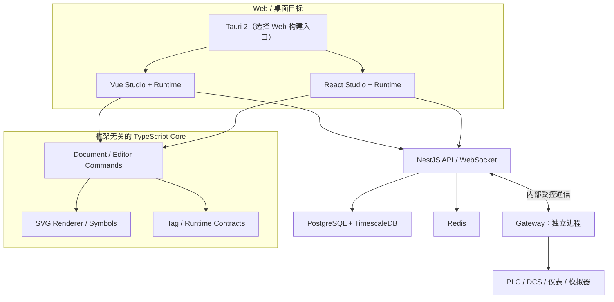
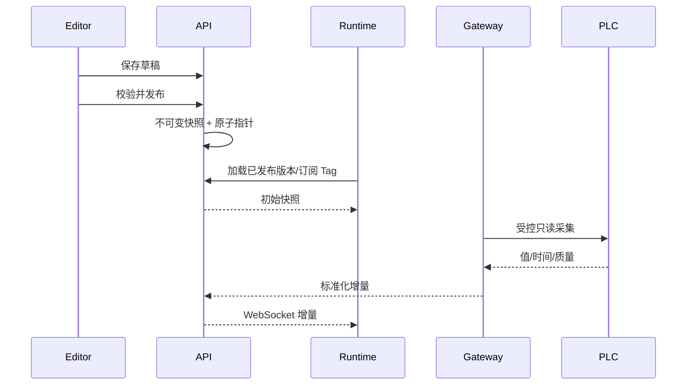

# ADui SCADA · 系统架构（目标设计）

> **大部分为目标设计。** V0.1 已有共享 Core/Runtime、Vue/React 最小 Web、NestJS 本地进程探针和 Tauri 2 桌面壳；工业 Gateway 尚未创建。实际目录见 [CODEBASE_MAP](CODEBASE_MAP.md)，实现边界见 [V0.1 实施记录](V0.1_IMPLEMENTATION.md)，范围见 [REQUIREMENTS](REQUIREMENTS.md)。

## 1. 架构原则

一份业务事实、一套版本化工程协议、两套 Vue/React 正式 UI；框架无关 Core；编辑与运行分离；独立工业网关；优先安全、可恢复和部署可维护性，不为微服务而拆分微服务。

## 2. 逻辑架构（目标）

Tauri 并非同时运行两种前端；将按构建目标分别选择。Server 处理认证、工程、发布、报警、历史、审计，Gateway 独立管理工业通信。**以上图示不表示相关模块已建成。**

## 3. 选型与状态

| 领域     | 目标方案                                | 现状                                     |
| -------- | --------------------------------------- | ---------------------------------------- |
| 工程     | Vite+ 1.5、pnpm workspace               | 已配置；原锁文件待目标环境复验           |
| Web      | Vue 3、React 19、TypeScript             | 已创建两个最小 Web Runtime                       |
| UI       | TDesign Vue Next、Ant Design            | 候选                                     |
| 2D       | SVG + 自研独立编辑/渲染核心             | V0.1 仅实现只读 SVG 图元和解析，无编辑器 |
| 共享数据 | Document / TagValue / 质量状态          | V0.1 已实现本地模拟核心，未持久化        |
| 3D       | Three.js 自研 Core + Vue/React adapters | 后续，非 V1 前置                         |
| 桌面     | Tauri 2                                 | 已创建 Windows 优先桌面壳；未验证打包                                     |
| 业务 API | NestJS                                  | 已创建本地 /health；业务 API 尚未实现                                     |
| 业务数据 | PostgreSQL + Prisma                     | 候选                                     |
| 历史库   | TimescaleDB                             | 候选；时序迁移独立管理                   |
| 实时     | WebSocket + Redis                       | 候选；V0.1 仅 demo 使用 localhost SSE    |
| 协议     | OPC UA / Modbus TCP / MQTT              | 目标；版本/驱动待 PoC                    |

## 4. 模块与依赖约束

长期目标：`core/document` 管 Schema/迁移；`editor-core` 管命令、撤销重做、几何；`renderer-svg` 管工业矢量图元；`tag-engine` 管类型、质量、快照和增量；`adapter-vue`、`adapter-react` 管框架生命周期及界面。运行时不得反向依赖编辑器；所有核心包不得依赖 Vue/React；前端不能直接连接 PLC。

V0.1 实际使用 `packages/core` 聚合 Document、TagStore、Simulator、SVG 的纯 TypeScript 实现，暂不为尚未稳定的接口建立多个空包。`examples/water-treatment` 是只监听 127.0.0.1 的模拟链路，用于检验工程 Schema、质量和只读可视化，不能直接视为生产 Runtime/API。Vue/React 展示适配已创建；鉴权和工业通信仍是未来工作。

3D 使用独立的 Three.js 引擎抽象，未来经共享设备 ID、Tag ID 与场景协议接入，不要求与 SVG 共享底层 Renderer。

V0.1 的 Tauri 通过默认配置嵌入 React 构建，可通过附加配置选择 Vue。Rust 主程序仅初始化空权限桌面壳，不含工业命令。NestJS Server 与模拟 SSE 服务是两个独立本地进程，当前二者没有业务对接；打包后的桌面应用不内置模拟 SSE。

## 5. 数据与发布流程（目标）

Tag 值保留源时间、接收时间、质量；网络异常触发 STALE/BAD 状态。多个浏览器订阅不能造成重复 PLC 连接。草稿修改不影响发布中画面。这些生产性质尚未通过实际验收。

## 6. 部署、安全与恢复

客户端 HTTPS/WSS → 平台网络 → 受控网关网络 → 现场 PLC；数据库、Redis 不对外开放。OPC UA 证书和访问策略、Modbus 受控网段、MQTT TLS/ACL 按现场要求配置。默认不开放通用写入；重要变更有审计。网关掉线、数据库暂不可用和 WebSocket 重连时，应提供质量与可恢复状态。V1 不声称 HA 或零数据丢失。

V0.1 不建立工业网络连接；模拟服务不可暴露到公网。演示的 SSE 不包含身份/权限模型，不得直接移用于正式运行环境。

## 7. 工具链与共享配置

根 `.editorconfig` 统一格式；`@adui/tsconfig` 提供 React、Vue、NestJS、Node、Core 和浏览器运行时的 TS 基础配置。根 `vite.config.ts` 从 `@adui/tooling` 引入 Format / Lint / Git staged 配置，利用 lint.overrides 应用框架路径规则，避免子应用独立工具配置造成漂移。TSConfig 应用的 include、rootDir、outDir 和 tsBuildInfoFile 保留在各自应用目录，所有第三方版本仍由 pnpm Catalog 控制。

## 8. 风险与 ADR

风险：双框架 UI 维护成本、图元高频渲染、协议兼容、数据量与存储成本、证书、Tauri WebView 差异。性能指标见 [NFR](REQUIREMENTS.md)，待压测后固化。

- [ADR-0001：双框架共享 Core](adr/0001-dual-framework-core.md) — Accepted
- [ADR-0002：网关隔离和只读优先](adr/0002-industrial-io-security.md) — Proposed
- [ADR-0003：pnpm Catalog / TypeScript / Vitest](adr/0003-toolchain-catalog-vitest.md) — Accepted
- [ADR-0004：Web Studio 与 Runtime 合并](adr/0004-unified-web-apps.md) — Accepted
- [ADR-0005：跨框架共享开发配置](adr/0005-shared-toolchain-config.md) — Accepted

重大架构变更应新增 ADR，保留历史决策。
