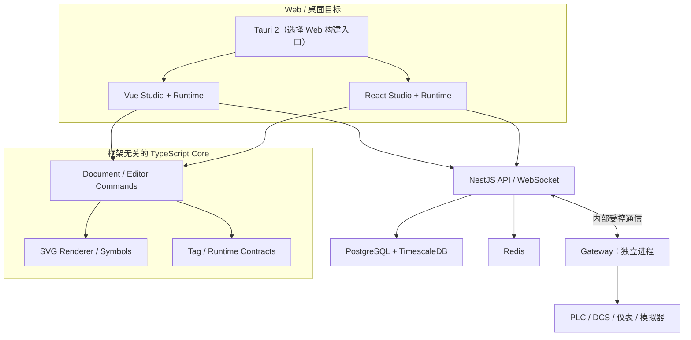
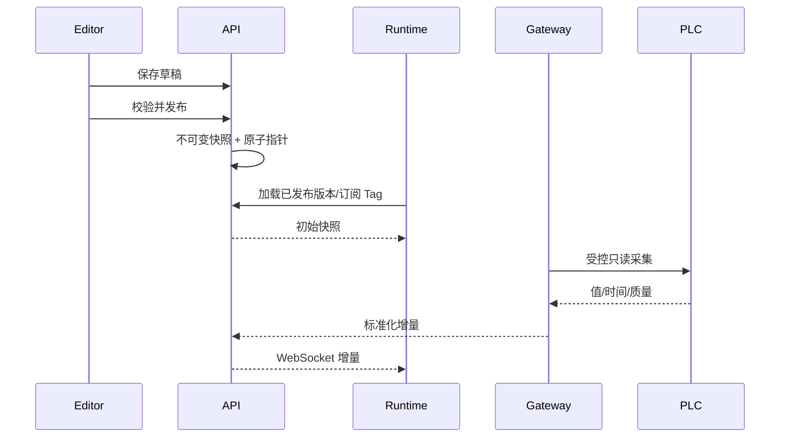

# ADui SCADA · 系统架构（目标设计）

> **大部分为目标设计。** V0.1 已有共享 Core/Runtime、Vue/React 最小 Web、NestJS 本地进程探针和 Tauri 2 桌面壳；工业 Gateway 尚未创建。实际目录见 [CODEBASE_MAP](CODEBASE_MAP.md)，实现边界见 [V0.1 实施记录](V0.1_IMPLEMENTATION.md)，范围见 [REQUIREMENTS](REQUIREMENTS.md)。

## 1. 架构原则

一份业务事实、一套版本化工程协议、两套 Vue/React 正式 UI；框架无关 Core；编辑与运行分离；独立工业网关；优先安全、可恢复和部署可维护性，不为微服务而拆分微服务。

## 2. 逻辑架构（目标）

Tauri 并非同时运行两种前端；将按构建目标分别选择。Server 处理认证、工程、发布、报警、历史、审计，Gateway 独立管理工业通信。**以上图示不表示相关模块已建成。**

## 3. 选型与状态

| 领域     | 目标方案                                | 现状                                     |
| -------- | --------------------------------------- | ---------------------------------------- |
| 工程     | Vite+ 1.5、pnpm workspace               | 已配置；原锁文件待目标环境复验           |
| Web      | Vue 3、React 19、TypeScript             | 已创建两个最小 Web Runtime               |
| UI       | TDesign Vue Next、Ant Design            | 候选                                     |
| 2D       | SVG + 自研独立编辑/渲染核心             | V0.1 只读；V0.2 首批本地 Studio 编辑命令 |
| 共享数据 | Document / TagValue / 质量状态          | V0.1 已实现本地模拟核心，未持久化        |
| 3D       | Three.js 自研 Core + Vue/React adapters | 后续，非 V1 前置                         |
| 桌面     | Tauri 2                                 | 已创建 Windows 优先桌面壳；未验证打包    |
| 业务 API | NestJS                                  | 已创建本地 /health；业务 API 尚未实现    |
| 业务数据 | PostgreSQL + Prisma                     | 候选                                     |
| 历史库   | TimescaleDB                             | 候选；时序迁移独立管理                   |
| 实时     | WebSocket + Redis                       | 候选；V0.1 仅 demo 使用 localhost SSE    |
| 协议     | OPC UA / Modbus TCP / MQTT              | 目标；版本/驱动待 PoC                    |

## 4. 模块与依赖约束

长期目标：`core/document` 管 Schema/迁移；`editor-core` 管命令、撤销重做、几何；`renderer-svg` 管工业矢量图元；`tag-engine` 管类型、质量、快照和增量；`adapter-vue`、`adapter-react` 管框架生命周期及界面。运行时不得反向依赖编辑器；所有核心包不得依赖 Vue/React；前端不能直接连接 PLC。

V0.1 实际使用 `packages/core` 聚合 Document、TagStore、Simulator、SVG 的纯 TypeScript 实现，暂不为尚未稳定的接口建立多个空包。`examples/water-treatment` 是只监听 127.0.0.1 的模拟链路，用于检验工程 Schema、质量和只读可视化，不能直接视为生产 Runtime/API。Vue/React 展示适配已创建；鉴权和工业通信仍是未来工作。

3D 使用独立的 Three.js 引擎抽象，未来经共享设备 ID、Tag ID 与场景协议接入，不要求与 SVG 共享底层 Renderer。

V0.1 的 Tauri 通过默认配置嵌入 React 构建，可通过附加配置选择 Vue。Rust 主程序仅初始化空权限桌面壳，不含工业命令。NestJS Server 与模拟 SSE 服务是两个独立本地进程，当前二者没有业务对接；打包后的桌面应用不内置模拟 SSE。

## 5. 数据与发布流程（目标）

Tag 值保留源时间、接收时间、质量；网络异常触发 STALE/BAD 状态。多个浏览器订阅不能造成重复 PLC 连接。草稿修改不影响发布中画面。这些生产性质尚未通过实际验收。

## 6. 部署、安全与恢复

客户端 HTTPS/WSS → 平台网络 → 受控网关网络 → 现场 PLC；数据库、Redis 不对外开放。OPC UA 证书和访问策略、Modbus 受控网段、MQTT TLS/ACL 按现场要求配置。默认不开放通用写入；重要变更有审计。网关掉线、数据库暂不可用和 WebSocket 重连时，应提供质量与可恢复状态。V1 不声称 HA 或零数据丢失。

V0.1 不建立工业网络连接；模拟服务不可暴露到公网。演示的 SSE 不包含身份/权限模型，不得直接移用于正式运行环境。

## 7. 工具链与共享配置

根 `.editorconfig` 统一格式；`@adui/tsconfig` 提供 React、Vue、NestJS、Node、Core 和浏览器运行时的 TS 基础配置。根 `vite.config.ts` 从 `@adui/tooling` 引入 Format / Lint / Git staged 配置，利用 lint.overrides 应用框架路径规则，避免子应用独立工具配置造成漂移。TSConfig 应用的 include、rootDir、outDir 和 tsBuildInfoFile 保留在各自应用目录，所有第三方版本仍由 pnpm Catalog 控制。

## 8. 风险与 ADR

风险：双框架 UI 维护成本、图元高频渲染、协议兼容、数据量与存储成本、证书、Tauri WebView 差异。性能指标见 [NFR](REQUIREMENTS.md)，待压测后固化。

- [ADR-0001：双框架共享 Core](adr/0001-dual-framework-core.md) — Accepted
- [ADR-0002：网关隔离和只读优先](adr/0002-industrial-io-security.md) — Proposed
- [ADR-0003：pnpm Catalog / TypeScript / Vitest](adr/0003-toolchain-catalog-vitest.md) — Accepted
- [ADR-0004：Web Studio 与 Runtime 合并](adr/0004-unified-web-apps.md) — Accepted
- [ADR-0005：跨框架共享开发配置](adr/0005-shared-toolchain-config.md) — Accepted

重大架构变更应新增 ADR，保留历史决策。

## V0.1 桌面安装版诊断模拟（ADR-0006）

Tauri 2 安装包只嵌入 Web 静态资源，不自动提供 Vite 开发代理或模拟 SSE HTTP 服务。为确保 V0.1 安装后演示可用，Tauri 的 Web 构建指定 `--mode desktop`，从共享 Core 加载水处理 Demo Document 和模拟器，`OfflineDemoRuntime` 在 JS 内存中生成模拟读数并演练 `STALE`，不打开网络连接或 Tauri 特权接口。Web 开发模式继续使用本地 SSE Harness，不能自动切换到离线模式掩盖服务器故障。

数据源状态必须明确标注 `SIMULATION`，用户不能将模拟 `GOOD` 值误认为现场采集质量。正式桌面应用后续应通过具备鉴权与审计的 NestJS/网关服务访问设备，离线历史数据需要另行设计；以上实现仅用于 V0.1 演示验收。[ADR-0006](adr/0006-desktop-offline-simulation.md)。

## V0.1 Docker 本地模拟栈（ADR-0007）

新增 [Docker Compose 演示](../deploy/docker/README.md)，供未来 Docker 化部署演进：React/Vue 两套 Vite+ Web 构建以 Nginx 静态服务分别监听宿主机 `127.0.0.1:8080` 与 `127.0.0.1:8081`；NestJS 健康检查和模拟 Node SSE 仅对容器内部网络开放。Nginx 同源转发 `/demo/project`、`/demo/events`、`/api/health`，不将 HTML fallback 误用为接口响应。

当前是没有鉴权、数据库、生产 API、工业 Gateway 的**演示部署**。不得将此 Compose 暴露到公网/工业现场。生产架构计划独立实现 HTTPS/WSS、网关网络隔离、身份授权、存储与备份。Tauri 桌面发行版继续走 Windows MSI，不进入 Docker Web 部署。见 [ADR-0007](adr/0007-docker-demo-deployment.md)。

## 环境变量与检出换行符（ADR-0010）

ADR-0008 的分散模板方案已被 [ADR-0010](adr/0010-root-env-lf.md) 取代。Vue/React Vite+ 配置通过同一个仓库根 `envDir` 加载 `SCADA_*`；Node 进程读取根 `.env`；Docker Compose 从工作目录根 `.env` 注入 Web 宿主机端口和容器内部服务端口，Nginx 在启动时把内部端口写入代理模板。容器仍只发布 loopback Web 端口，服务端/模拟器不对宿主机公开。

根 `.gitattributes` 将文本检出规范为 LF，与 `.editorconfig` / Oxfmt 一致，减少 Windows 上 Git CRLF ↔ Oxfmt LF 的反复变更。设备、真实网关、生产凭据和控制写入未引入。

## V0.2 Studio 第一阶段：编辑与运行隔离（ADR-0009）

`packages/core/src/editor.ts` 以单独 `@adui/scada-core/editor` 子路径导出框架无关 Editor API。Vue/React 各自拥有 `src/studio/StudioPage`，App 入口按需加载 Studio 与 Runtime；Runtime 代码不 import Editor 入口。工程继续使用原有 `ScadaDocument`、`renderSvgPage` 与 Tag ID，不更改 Schema 版本，也不新增 Workspace 包或依赖。

编辑命令本地不可变、校验、最多 100 步撤销历史；JSON 导入/导出只是本地草稿。服务端工程 CRUD、发布版本与真实工业运行仍未实现，不能把 Studio 的导出等同于安全发布。见 [ADR-0009](adr/0009-studio-editor-foundation.md)。

## V0.2 Studio 第二批：共享编辑命令语义（ADR-0011）

仍沿用独立 `@adui/scada-core/editor` 子入口，增加多选、节点增删、批量平移、对齐、图层排序与可逆命令；React/Vue 分别承担指针交互和 UI，视图缩放不会污染共享 Schema。所有新增图元的 `bindings` 均为空，不能借编辑器操作接入真实 PLC/DCS；Runtime 不依赖 Editor。

设计细则与取舍见 [ADR-0011](adr/0011-editor-canvas-operations.md)。

## V0.2 画布网格与吸附几何（ADR-0012）

共享 Core 的 `snap.ts` 负责可重复的网格/图元参考线吸附计算；React/Vue 分别呈现纯视图网格与辅助线，并使用相同位移结果调用共享的编辑命令。此能力不引入框架依赖、第三方包或新 Schema 字段；Runtime、模拟数据与工业安全边界不变。详见 [ADR-0012](adr/0012-grid-snap-guides.md)。

## V0.2 图元属性编辑命令（ADR-0013）

图元几何属性 `x/y/width/height/rotation` 的校验、原子提交与撤销由框架无关 `@adui/scada-core/editor` 统一负责；React 和 Vue 仅采集本地数值表单输入并显示结果。继续使用 `ScadaDocument 0.1.0` 与现有渲染器，不新增依赖、页面状态或设备写入接口。具体约束见 [ADR-0013](adr/0013-node-transform-properties.md)。

## V0.2 SVG 缩放与旋转控制手柄（ADR-0014）

Vue/React 的 SVG 编辑层负责显示控制点、捕获 Pointer 和提供预览；`@adui/scada-core/editor` 内独立的 `transform-gesture.ts` 负责旋转坐标换算、对角锚点固定及角度吸附。所有预览/最终提交由现有 `withNodeTransform` / `DocumentEditor.updateSelectedTransform` 校验与入历史，Runtime 不引入手柄逻辑。工程 JSON 契约和工业安全边界不变。[ADR-0014](adr/0014-svg-transform-handles.md)。

## V0.2 八方向缩放与旋转锚点（ADR-0015）

`@adui/scada-core/editor` 的 `transform-gesture.ts` 统一计算八方向局部手柄位置、中文名称、单轴或双轴尺寸变换与旋转锚点；Vue/React 仅承载 SVG 交互视图，继续调用原 `withNodeTransform` 和编辑器撤销命令。相对前一批只扩展共享纯函数与两套手柄展示，不增加第三方依赖或 Schema 字段。详细取舍参见 [ADR-0015](adr/0015-eight-direction-resize.md)。

## V0.2 Shift 等比例缩放（ADR-0016）

沿用框架无关 `@adui/scada-core/editor` 下的 `transform-gesture.ts` 计算。通过向 `resolveResizeTransform` 增加默认关闭的锁比例参数实现等比例变形，Vue/React 仅转交 Pointer 事件中的 `shiftKey` 并展示 SVG 手柄提示。保持 `withNodeTransform` 校验、原子历史、共享 JSON Schema、Tag 绑定和 Runtime 边界不变。详见 [ADR-0016](adr/0016-aspect-ratio-resize.md)。

## V0.2 平面图元组合（ADR-0017）

为减少对已有 SVG Core 与 Runtime 的影响，在共享 `ScadaNode` 加入**可选逻辑组合 ID**，仍保留节点的平面结构及绘制顺序。`packages/core/src/grouping.ts` 只为 Editor 的移动、选中和吸附计算提供共享组员扩展；Vue/React 只负责选择、组合/解组按钮与中文状态展示。组合元数据的输入验证集中在现有 `parseScadaDocument`，原编辑历史保持最多 100 次。此版本不引入新 npm 依赖、不增加工业控制接口，跨版本数据语义与风险见 [ADR-0017](adr/0017-node-grouping.md)。

## V0.2 Schema 版本校验与迁移边界（ADR-0018）

`@adui/scada-core` 的文档层区分 **当前版本校验** `parseScadaDocument` 与 **历史导入** `migrateScadaDocument`。共享 Editor、SVG 和 Runtime 只解析 `0.2.0`；仅 Studio 本地导入通过 `DocumentEditor.loadDocument` 调用历史迁移。对未知版本与不支持的结构字段明确拒绝，避免旧客户端重新保存时静默丢失 `groupId`；Vue/React 使用统一迁移结果和提示。保持共享 Core 无框架依赖、Runtime 不依赖 Editor、工业设备只读边界。详见 [ADR-0018](adr/0018-schema-version-migration.md)。
