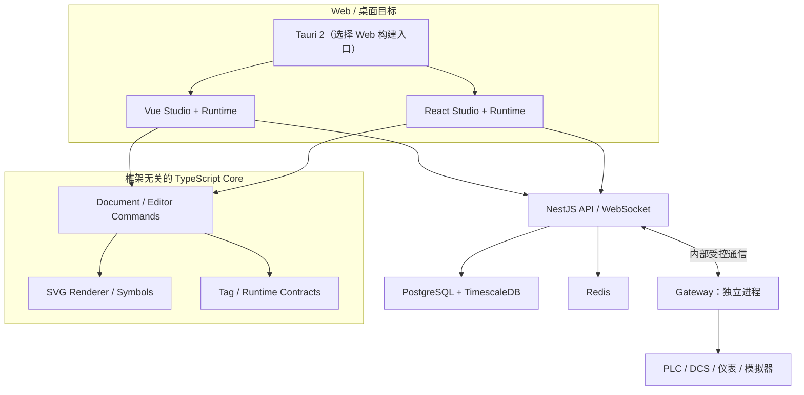
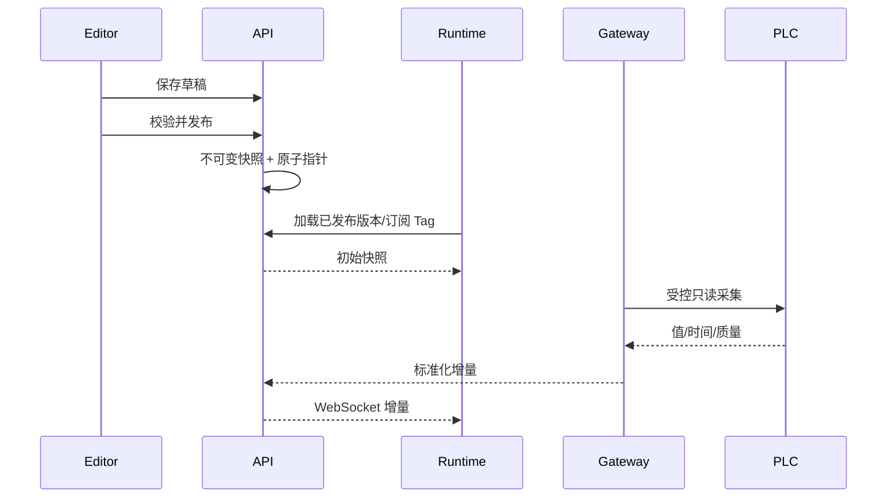

# ADui SCADA · 系统架构（目标设计）

> **大部分为目标设计。** V0.1 已有共享 Core/Runtime、Vue/React 最小 Web、NestJS 本地进程探针和 Tauri 2 桌面壳；工业 Gateway 尚未创建。实际目录见 [CODEBASE_MAP](CODEBASE_MAP.md)，实现边界见 [V0.1 实施记录](V0.1_IMPLEMENTATION.md)，范围见 [REQUIREMENTS](REQUIREMENTS.md)。

## 1. 架构原则

一份业务事实、一套版本化工程协议、两套 Vue/React 正式 UI；框架无关 Core；编辑与运行分离；独立工业网关；优先安全、可恢复和部署可维护性，不为微服务而拆分微服务。

## 2. 逻辑架构（目标）

Tauri 并非同时运行两种前端；将按构建目标分别选择。Server 处理认证、工程、发布、报警、历史、审计，Gateway 独立管理工业通信。**以上图示不表示相关模块已建成。**

## 3. 选型与状态

| 领域     | 目标方案                                | 现状                                     |
| -------- | --------------------------------------- | ---------------------------------------- |
| 工程     | Vite+ 1.5、pnpm workspace               | 已配置；原锁文件待目标环境复验           |
| Web      | Vue 3、React 19、TypeScript             | 已创建两个最小 Web Runtime               |
| UI       | TDesign Vue Next、Ant Design            | 候选                                     |
| 2D       | SVG + 自研独立编辑/渲染核心             | V0.1 只读；V0.2 首批本地 Studio 编辑命令 |
| 共享数据 | Document / TagValue / 质量状态          | V0.1 已实现本地模拟核心，未持久化        |
| 3D       | Three.js 自研 Core + Vue/React adapters | 后续，非 V1 前置                         |
| 桌面     | Tauri 2                                 | 已创建 Windows 优先桌面壳；未验证打包    |
| 业务 API | NestJS                                  | 已创建本地 /health；业务 API 尚未实现    |
| 业务数据 | PostgreSQL + Prisma                     | 候选                                     |
| 历史库   | TimescaleDB                             | 候选；时序迁移独立管理                   |
| 实时     | WebSocket + Redis                       | 候选；V0.1 仅 demo 使用 localhost SSE    |
| 协议     | OPC UA / Modbus TCP / MQTT              | 目标；版本/驱动待 PoC                    |

## 4. 模块与依赖约束

长期目标：`core/document` 管 Schema/迁移；`editor-core` 管命令、撤销重做、几何；`renderer-svg` 管工业矢量图元；`tag-engine` 管类型、质量、快照和增量；`adapter-vue`、`adapter-react` 管框架生命周期及界面。运行时不得反向依赖编辑器；所有核心包不得依赖 Vue/React；前端不能直接连接 PLC。

V0.1 实际使用 `packages/core` 聚合 Document、TagStore、Simulator、SVG 的纯 TypeScript 实现，暂不为尚未稳定的接口建立多个空包。`examples/water-treatment` 是只监听 127.0.0.1 的模拟链路，用于检验工程 Schema、质量和只读可视化，不能直接视为生产 Runtime/API。Vue/React 展示适配已创建；鉴权和工业通信仍是未来工作。

3D 使用独立的 Three.js 引擎抽象，未来经共享设备 ID、Tag ID 与场景协议接入，不要求与 SVG 共享底层 Renderer。

V0.1 的 Tauri 通过默认配置嵌入 React 构建，可通过附加配置选择 Vue。Rust 主程序仅初始化空权限桌面壳，不含工业命令。NestJS Server 与模拟 SSE 服务是两个独立本地进程，当前二者没有业务对接；打包后的桌面应用不内置模拟 SSE。

## 5. 数据与发布流程（目标）

Tag 值保留源时间、接收时间、质量；网络异常触发 STALE/BAD 状态。多个浏览器订阅不能造成重复 PLC 连接。草稿修改不影响发布中画面。这些生产性质尚未通过实际验收。

## 6. 部署、安全与恢复

客户端 HTTPS/WSS → 平台网络 → 受控网关网络 → 现场 PLC；数据库、Redis 不对外开放。OPC UA 证书和访问策略、Modbus 受控网段、MQTT TLS/ACL 按现场要求配置。默认不开放通用写入；重要变更有审计。网关掉线、数据库暂不可用和 WebSocket 重连时，应提供质量与可恢复状态。V1 不声称 HA 或零数据丢失。

V0.1 不建立工业网络连接；模拟服务不可暴露到公网。演示的 SSE 不包含身份/权限模型，不得直接移用于正式运行环境。

## 7. 工具链与共享配置

根 `.editorconfig` 统一格式；`@adui/tsconfig` 提供 React、Vue、NestJS、Node、Core 和浏览器运行时的 TS 基础配置。根 `vite.config.ts` 从 `@adui/tooling` 引入 Format / Lint / Git staged 配置，利用 lint.overrides 应用框架路径规则，避免子应用独立工具配置造成漂移。TSConfig 应用的 include、rootDir、outDir 和 tsBuildInfoFile 保留在各自应用目录，所有第三方版本仍由 pnpm Catalog 控制。

## 8. 风险与 ADR

风险：双框架 UI 维护成本、图元高频渲染、协议兼容、数据量与存储成本、证书、Tauri WebView 差异。性能指标见 [NFR](REQUIREMENTS.md)，待压测后固化。

- [ADR-0001：双框架共享 Core](adr/0001-dual-framework-core.md) — Accepted
- [ADR-0002：网关隔离和只读优先](adr/0002-industrial-io-security.md) — Proposed
- [ADR-0003：pnpm Catalog / TypeScript / Vitest](adr/0003-toolchain-catalog-vitest.md) — Accepted
- [ADR-0004：Web Studio 与 Runtime 合并](adr/0004-unified-web-apps.md) — Accepted
- [ADR-0005：跨框架共享开发配置](adr/0005-shared-toolchain-config.md) — Accepted

重大架构变更应新增 ADR，保留历史决策。

## V0.1 桌面安装版诊断模拟（ADR-0006）

Tauri 2 安装包只嵌入 Web 静态资源，不自动提供 Vite 开发代理或模拟 SSE HTTP 服务。为确保 V0.1 安装后演示可用，Tauri 的 Web 构建指定 `--mode desktop`，从共享 Core 加载水处理 Demo Document 和模拟器，`OfflineDemoRuntime` 在 JS 内存中生成模拟读数并演练 `STALE`，不打开网络连接或 Tauri 特权接口。Web 开发模式继续使用本地 SSE Harness，不能自动切换到离线模式掩盖服务器故障。

数据源状态必须明确标注 `SIMULATION`，用户不能将模拟 `GOOD` 值误认为现场采集质量。正式桌面应用后续应通过具备鉴权与审计的 NestJS/网关服务访问设备，离线历史数据需要另行设计；以上实现仅用于 V0.1 演示验收。[ADR-0006](adr/0006-desktop-offline-simulation.md)。

## V0.1 Docker 本地模拟栈（ADR-0007）

新增 [Docker Compose 演示](../deploy/docker/README.md)，供未来 Docker 化部署演进：React/Vue 两套 Vite+ Web 构建以 Nginx 静态服务分别监听宿主机 `127.0.0.1:8080` 与 `127.0.0.1:8081`；NestJS 健康检查和模拟 Node SSE 仅对容器内部网络开放。Nginx 同源转发 `/demo/project`、`/demo/events`、`/api/health`，不将 HTML fallback 误用为接口响应。

当前是没有鉴权、数据库、生产 API、工业 Gateway 的**演示部署**。不得将此 Compose 暴露到公网/工业现场。生产架构计划独立实现 HTTPS/WSS、网关网络隔离、身份授权、存储与备份。Tauri 桌面发行版继续走 Windows MSI，不进入 Docker Web 部署。见 [ADR-0007](adr/0007-docker-demo-deployment.md)。

## 环境变量与检出换行符（ADR-0010）

ADR-0008 的分散模板方案已被 [ADR-0010](adr/0010-root-env-lf.md) 取代。Vue/React Vite+ 配置通过同一个仓库根 `envDir` 加载 `SCADA_*`；Node 进程读取根 `.env`；Docker Compose 从工作目录根 `.env` 注入 Web 宿主机端口和容器内部服务端口，Nginx 在启动时把内部端口写入代理模板。容器仍只发布 loopback Web 端口，服务端/模拟器不对宿主机公开。

根 `.gitattributes` 将文本检出规范为 LF，与 `.editorconfig` / Oxfmt 一致，减少 Windows 上 Git CRLF ↔ Oxfmt LF 的反复变更。设备、真实网关、生产凭据和控制写入未引入。

## V0.2 Studio 第一阶段：编辑与运行隔离（ADR-0009）

`packages/core/src/editor.ts` 以单独 `@adui/scada-core/editor` 子路径导出框架无关 Editor API。Vue/React 各自拥有 `src/studio/StudioPage`，App 入口按需加载 Studio 与 Runtime；Runtime 代码不 import Editor 入口。工程继续使用原有 `ScadaDocument`、`renderSvgPage` 与 Tag ID，不更改 Schema 版本，也不新增 Workspace 包或依赖。

编辑命令本地不可变、校验、最多 100 步撤销历史；JSON 导入/导出只是本地草稿。服务端工程 CRUD、发布版本与真实工业运行仍未实现，不能把 Studio 的导出等同于安全发布。见 [ADR-0009](adr/0009-studio-editor-foundation.md)。

## V0.2 Studio 第二批：共享编辑命令语义（ADR-0011）

仍沿用独立 `@adui/scada-core/editor` 子入口，增加多选、节点增删、批量平移、对齐、图层排序与可逆命令；React/Vue 分别承担指针交互和 UI，视图缩放不会污染共享 Schema。所有新增图元的 `bindings` 均为空，不能借编辑器操作接入真实 PLC/DCS；Runtime 不依赖 Editor。

设计细则与取舍见 [ADR-0011](adr/0011-editor-canvas-operations.md)。

## V0.2 画布网格与吸附几何（ADR-0012）

共享 Core 的 `snap.ts` 负责可重复的网格/图元参考线吸附计算；React/Vue 分别呈现纯视图网格与辅助线，并使用相同位移结果调用共享的编辑命令。此能力不引入框架依赖、第三方包或新 Schema 字段；Runtime、模拟数据与工业安全边界不变。详见 [ADR-0012](adr/0012-grid-snap-guides.md)。

## V0.2 图元属性编辑命令（ADR-0013）

图元几何属性 `x/y/width/height/rotation` 的校验、原子提交与撤销由框架无关 `@adui/scada-core/editor` 统一负责；React 和 Vue 仅采集本地数值表单输入并显示结果。继续使用 `ScadaDocument 0.1.0` 与现有渲染器，不新增依赖、页面状态或设备写入接口。具体约束见 [ADR-0013](adr/0013-node-transform-properties.md)。

## V0.2 SVG 缩放与旋转控制手柄（ADR-0014）

Vue/React 的 SVG 编辑层负责显示控制点、捕获 Pointer 和提供预览；`@adui/scada-core/editor` 内独立的 `transform-gesture.ts` 负责旋转坐标换算、对角锚点固定及角度吸附。所有预览/最终提交由现有 `withNodeTransform` / `DocumentEditor.updateSelectedTransform` 校验与入历史，Runtime 不引入手柄逻辑。工程 JSON 契约和工业安全边界不变。[ADR-0014](adr/0014-svg-transform-handles.md)。

## V0.2 八方向缩放与旋转锚点（ADR-0015）

`@adui/scada-core/editor` 的 `transform-gesture.ts` 统一计算八方向局部手柄位置、中文名称、单轴或双轴尺寸变换与旋转锚点；Vue/React 仅承载 SVG 交互视图，继续调用原 `withNodeTransform` 和编辑器撤销命令。相对前一批只扩展共享纯函数与两套手柄展示，不增加第三方依赖或 Schema 字段。详细取舍参见 [ADR-0015](adr/0015-eight-direction-resize.md)。

## V0.2 Shift 等比例缩放（ADR-0016）

沿用框架无关 `@adui/scada-core/editor` 下的 `transform-gesture.ts` 计算。通过向 `resolveResizeTransform` 增加默认关闭的锁比例参数实现等比例变形，Vue/React 仅转交 Pointer 事件中的 `shiftKey` 并展示 SVG 手柄提示。保持 `withNodeTransform` 校验、原子历史、共享 JSON Schema、Tag 绑定和 Runtime 边界不变。详见 [ADR-0016](adr/0016-aspect-ratio-resize.md)。

## V0.2 平面图元组合（ADR-0017）

为减少对已有 SVG Core 与 Runtime 的影响，在共享 `ScadaNode` 加入**可选逻辑组合 ID**，仍保留节点的平面结构及绘制顺序。`packages/core/src/grouping.ts` 只为 Editor 的移动、选中和吸附计算提供共享组员扩展；Vue/React 只负责选择、组合/解组按钮与中文状态展示。组合元数据的输入验证集中在现有 `parseScadaDocument`，原编辑历史保持最多 100 次。此版本不引入新 npm 依赖、不增加工业控制接口，跨版本数据语义与风险见 [ADR-0017](adr/0017-node-grouping.md)。

## V0.2 Schema 版本校验与迁移边界（ADR-0018）

`@adui/scada-core` 的文档层区分 **当前版本校验** `parseScadaDocument` 与 **历史导入** `migrateScadaDocument`。共享 Editor、SVG 和 Runtime 只解析 `0.2.0`；仅 Studio 本地导入通过 `DocumentEditor.loadDocument` 调用历史迁移。对未知版本与不支持的结构字段明确拒绝，避免旧客户端重新保存时静默丢失 `groupId`；Vue/React 使用统一迁移结果和提示。保持共享 Core 无框架依赖、Runtime 不依赖 Editor、工业设备只读边界。详见 [ADR-0018](adr/0018-schema-version-migration.md)。

## V0.2 本地草稿持久化与恢复（ADR-0019）

共享 `packages/core/src/local-draft.ts` 只依赖已验证的 `ScadaDocument 0.2.0` 和注入式 `LocalDraftStorage` 接口，不直接依赖 DOM 或前端框架。Vue/React Studio 分别适配 `window.localStorage`，提供同样的手动保存、恢复和清除入口。记录按 `projectId` 与浏览器 Origin 隔离；恢复操作先验证记录，再调用 `DocumentEditor.loadDocument` 完成原子替换。只读 Runtime、NestJS 和工业网关均不依赖本地草稿。浏览器本地草稿不是加密存储或正式工程备份，见 [ADR-0019](adr/0019-local-draft-persistence.md)。

## V0.2 本地草稿按需自动保存（ADR-0020）

继续使用 `@adui/scada-core` 的共享 `LocalDraftStorage`/Schema 校验，在 `local-draft.ts` 封装框架无关的 `LocalDraftAutoSaveSession`：工程内容脏状态判定、原始存储记录比对与拒绝冲突覆盖。Vue/React 各自用生命周期实现相同的 1000 ms 延迟写入、显式开启/暂停与浏览器 `storage` 事件停写。恢复仍显式确认，`Runtime`、NestJS、工业网关及设备写入完全不参与。浏览器无法提供原子多标签页事务，属于尽力冲突检测而非严格排他锁。详见 [ADR-0020](adr/0020-safe-local-autosave.md)。

## V0.2 浏览器工程 IndexedDB 事务仓储（ADR-0021）

在 Core 的框架无关编辑器与真实浏览器之间加入 `@adui/scada-draft-storage`，由 `DexieDraftRepository` 独占浏览器数据库适配与迁移，底层采用 IndexedDB、Dexie.js 和单事务修订号比较。Core 新增仅含 TypeScript 的 `DraftRepository` / `DraftAutoSaveSession` 异步接口，Vue 和 React 都消费该契约，跨框架不复制数据库规则。旧 `localStorage` 仅作一次性历史数据迁移来源。通过 `BroadcastChannel` 加速同 Origin 标签页状态通知，版本一致性由数据库事务负责。工业只读 Runtime、NestJS、Gateway 和工程发布边界不变。参考 [ADR-0021](adr/0021-indexeddb-dexie-storage.md)。

## V0.2 多页面 Studio 编辑作用域（ADR-0022）

共享 Core 负责当前页面会话状态、页面编辑命令与历史上下文。框架适配层只实现页面导航与指针生命周期，不复制文档规则；拖动吸附与 SVG 预览通过可选 `pageId` 明确作用于当前页，旧单页面调用默认第一页兼容。工程 JSON/IndexedDB 仍保存整份 `ScadaDocument 0.2.0`，不包含 `activePageId`；页面切换不产生保存写入。新增页面、重命名和删除按现有自动保存流程提交，删除最后一页被拒绝。详见 [ADR-0022](adr/0022-multi-page-editor-scope.md)。

## V0.2 页面复制与工程 ID 命名空间（ADR-0023）

页面复制和跨页选中图元复制由框架无关 `DocumentEditor` 统一执行：页面、图元、组合共享全工程唯一 ID 空间，新副本重映射 ID 并保留 Tag 绑定及组内关系。页面排序直接修改 `ScadaDocument.pages` 顺序，因此现有 Runtime 的默认第一页展示也会改变；不另设启动页，也不变更 Schema `0.2.0`。在目标画布较小时，跨页复制整体平移以保留相对布局，无法容纳则原子拒绝。Vue/React 仅提供导航与操作入口，Dexie IndexedDB 继续使用既有整工程版本事务，不涉及真实设备写入。详见 [ADR-0023](adr/0023-page-copy-and-reordering.md)。

## V0.2 会话图元剪贴板（ADR-0024）

剪贴板状态仅由共享 `DocumentEditor` 管理，包含从受校验工程复制的节点与成功粘贴计数。Vue/React 只适配工作区按钮和快捷键，不读写系统剪贴板、没有新的外部依赖。粘贴复用现有全工程唯一 ID、组映射和 Parser 原子校验，允许不同页面复用但禁止导入新工程后残留旧剪贴板。只有剪切和粘贴改变文档并进入撤销历史及既有 Dexie 草稿机制；纯复制、页面切换、剪贴板快照不进入工程 Schema `0.2.0`。工业只读数据通路保持原状。详见 [ADR-0024](adr/0024-session-node-clipboard.md)。

## V0.2 图元锁定与可见性（ADR-0025）

图元锁定与隐藏语义统一在框架无关 SCADA Core 及 SVG Runtime。为避免在 `ScadaDocument 0.2.0` 增加会被旧版严格白名单拒绝的新顶层字段，使用 `props.__scadaStudio` 中经校验的 `locked`、`visible` 可选布尔值；Vue/React 只负责批量命令 UI、图层状态标记及画布手势适配。编辑命令与提交边界共同阻止锁定图元的误修改，Runtime 只渲染可见节点，不改变 Tag 数据质量或工业只读链路。**旧 Runtime 不解释隐藏状态**，后续发布链必须校验运行端能力，不可将此批视为正式版本协商。详见 [ADR-0025](adr/0025-node-lock-visibility.md)。

## V0.2 精确图层排序与组合连续性（ADR-0026）

继续保持 `ScadaDocument 0.2.0` 中每页 `nodes[]` 为唯一 SVG 图层顺序来源，后项覆盖前项；不维护独立 `zIndex`。共享 `DocumentEditor.moveLayer` 按目标图元/组合边界插入原始节点，源组移动时完整连续搬运，中央 Core 检查锁定图元原始索引不受其他图元移动影响。React/Vue 仅负责逆序列表、HTML5 拖放位置和可访问的精确选择操作；未采用第三方拖拽库，也不解析外部拖拽数据。变更沿用 JSON、撤销历史和 Dexie 草稿，Runtime 只读语义不变。详见 [ADR-0026](adr/0026-precise-layer-order.md)。

## V0.2 组合图层树投影（ADR-0027）

为保持共享 `ScadaDocument 0.2.0` 的扁平图层与 `groupId` 契约，树形图层面板采用框架无关 `buildLayerTree` 纯函数进行**只读投影**，不引入新的组实体、嵌套组关系或 Runtime 依赖。投影按 `nodes[]` 的真实绘制层序生成组标题与成员、统一搜索过滤及锁定/隐藏统计，并明确标记历史非连续组合。Vue/React 分别维护折叠/搜索/定位会话状态，点击组和成员仍调用 `DocumentEditor.select`，拖拽仍调用 `moveLayer`，保持权限边界及撤销历史一致。JSON 与 Dexie IndexedDB 草稿不持久化这类 UI 视图状态；只读 Runtime 与生产设备写入安全约束不变。参见 [ADR-0027](adr/0027-layer-group-tree-projection.md)。

## V0.2 双框架 TDesign UI 技术选型（ADR-0028）

根据维护者 2026-11-11 的明确决策，React 与 Vue 3 Web Studio 均采用腾讯 TDesign：React 为 `tdesign-react` / `tdesign-icons-react`，Vue 为 `tdesign-vue-next` / `tdesign-icons-vue-next`。根 pnpm Catalog 统一固定依赖版本，Studio 按需导入组件与官方样式。框架相关 UI 状态不进入 Core 或 Runtime：共享 `GEOMETRY_PROPERTY_FIELDS`、`DocumentEditor`、ScadaDocument `0.2.0` 和 Dexie IndexedDB 草稿协议均保持框架无关。迁移从 Studio 属性面板和图层搜索开始，旧原生表单按批次替换，不引入 Ant Design，也不把 TDesign 视为工业设备数据或权限的来源。详见 [ADR-0028](adr/0028-tdesign-dual-framework-ui.md)。

## V0.3 第二批：共享工程快照基础（ADR-0035）

`@adui/scada-core` 新增框架无关 `project-snapshot.ts`，仅依赖现有 `ScadaDocument 0.2.0` Parser 与运行环境原生 WebCrypto。它提供结构校验结果、SHA-256 完整性摘要、带元数据的深冻结工程快照和严格回读；不依赖 Vue、React、NestJS、Dexie 或浏览器 DOM API。应用、存储、版本指针、身份权限与工业协议均不得进入 Core；后续发布服务必须独立解决并发、审计、存储事务和运行时版本切换。本批仍为离线能力，详见 [ADR-0035](adr/0035-project-validation-snapshot.md)。

## V0.3 第三批：浏览器本地历史仓储（ADR-0036）

共享 Core 仅声明 `ProjectVersionRepository` 和历史摘要，WebCrypto SHA-256 快照继续复用现有 `project-snapshot.ts`。独立 `@adui/scada-draft-storage` 的 Dexie 适配提供浏览器同 Origin 内追加历史版本、事务 CAS 修订号及倒序分页。历史库 `adui-scada-studio-versions` 与已存在的草稿库 `adui-scada-studio` 分开，不改变任何已有数据库迁移。未来 PostgreSQL/NestJS 版本仓储应单独实现权限及审计；浏览器 head 不属于正式已发布版本指针，不能连接工业生产 Runtime。详见 [ADR-0036](adr/0036-local-version-history.md)。

## V0.3 第四批：双框架版本历史管理 UI（ADR-0037）

Vue/React Studio 通过共同的 `@adui/scada-core` 比较契约、`@adui/scada-draft-storage` 独立历史仓储访问各自浏览器 Origin 的本地版本，样式统一在 `@adui/tailwind/studio.css`。用户确认后调用现有编辑器载入入口，不接入 Runtime 发布指针、服务端 API、工业网关或设备写入。浏览器历史不保证跨 Origin/跨设备共享，正式工程仓储仍需服务端权限及事务设计。

## V0.3 第五批：本地历史恢复可靠性（ADR-0038）

继续复用 `DraftAutoSaveSession` 的队列化异步写入与 `stop()` 停写承诺，双框架只通过现有操作门闩防止 JSON 导入和历史恢复并发修改。安全回归在隔离 Chrome/Edge profile 内使用实际 IndexedDB，覆盖撤销确认、历史持久化、Origin 隔离和模拟 IndexedDB 拒绝打开。未修改共享 Schema、Runtime、数据库结构或工业服务；这仍是浏览器本地一致性保障，不是服务端发布事务或工业安全认证。

## V0.3 第八批：受控服务端持久化边界（ADR-0040）

共享 Core 新增无框架依赖的 `parseServerProjectSaveRequest` 作为**纯请求结构校验**，供未来 NestJS 服务复用；该函数不负责认证、授权、CAS、审计或写入。未来服务端调用顺序必须是：认证（可信主体）→ 工程级授权 → 请求体与 Schema 校验 → 数据库事务内修订号 CAS → 生成不可变快照与持久化 → 审计。未确定服务端信任模型、数据库和访问策略前，**NestJS 不注册工程保存、发布或回滚路由**；不改变只读工业边界。

## V0.3 第九批：服务端工程权限与事务仓储候选设计（ADR-0041）

候选 PostgreSQL 存储按 `(tenant_id, project_id)` 复合主键隔离工程，服务端维护工程 head 修订号、只追加版本快照、逐权限授权记录与提交成功的审计事件。写入事务必须对工程行加锁、以客户端 `expectedRevision` 对比真实 head，写入版本、更新 head 和审计记录在**同一事务**提交或全部回滚；撤销工程授权的流程也必须锁同一工程行，避免授权撤销与保存交叉执行。

`apps/server/src/projects/project-access-policy.ts` 仅提供 NestJS 侧无副作用、默认拒绝的权限判定，不属于 Core 或可对外调用的认证服务。正式生产读写路径必须接入可信身份、工程 ACL 查询、受控数据源和持久审计；在这些能力交付之前继续只注册 `GET /health`，不新增 `/api/projects` 或工业写入路由。

## V0.3 第十批：PostgreSQL + Prisma 7 持久化基础（ADR-0042）

按用户确认采用 PostgreSQL + Prisma ORM，**不是 Prisma Postgres 云数据库**。Prisma 7 CLI、Client、`@prisma/adapter-pg` 统一通过根 pnpm Catalog 锁定，Schema 和 Migrate 配置仅位于 NestJS 服务端；生成客户端在 `apps/server/src/generated/prisma`，不进入共享 Core、Vue 或 React。根 `.env` 配置数据库连接，默认 NestJS 不初始化数据库连接且 `/health` 不被误用为数据库健康验证。

ADR-0041 的工程/ACL/版本/审计复合隔离模型转为首次迁移草案，包含不能由 Prisma Schema 单独表达的 PostgreSQL CHECK 约束。独立本地开发 PostgreSQL 可用 Docker Compose 启动，迁移验证应在隔离实例完成；在可信身份、授权 Guard、PrismaService、事务仓储和完整审计实现前，工程版本读写接口继续保持 404。

## V0.3 第十一批：Prisma 7 工程事务仓储（ADR-0043）

NestJS 服务端增加 `PrismaService`（应用生命周期内单实例 Client + 现有 `@prisma/adapter-pg`）及 `PrismaProjectVersionStore`，以隔离 `ProjectPersistenceModule` 提供受控读写能力；**不导入现有 AppModule**，进程健康接口保持不依赖 PostgreSQL。共享 Core 继续负责请求 Schema 和版本 SHA-256 校验，客户端 Vue/React 不引入 Prisma。

仓储在 PostgreSQL 事务内通过参数化 `$queryRaw` 获取工程行锁并复查 ACL；版本新增、head 和成功审计属于一个 Prisma Interactive Transaction，失败由 Prisma 自动回滚。真实并发竞争、跨租户访问等另设专用本地测试数据库，不默认纳入 `ready`。未上线可信认证或工程级 Guard 前，严禁注册工程版本 HTTP 路由。

服务端 Docker 运行镜像需随工作区依赖一并复制 `packages/core` 的包清单和源码，才能让 Node 24 从编译后的 NestJS 模块按工作区导出加载共享 Core；本批补齐该依赖，仍不导入工程写入控制器。

### PostgreSQL 中文元数据注释规范

Prisma `schema.prisma` 的 `///` 为代码生成文档信息，**不会自动创建 PostgreSQL 的表/字段注释**。依据仓库 `postgresql-table-design` Skill，现以增量 Prisma Migration 的 `COMMENT ON TABLE/COLUMN/INDEX` 为数据库注释权威来源；对已应用的初始建表迁移不做历史修改。四张业务表、23 个物理字段及四个业务索引均补充中文说明；Prisma 自管理的 `_prisma_migrations` 不受业务注释规则约束。后续增表需在同批迁移中同步注释，静态测试与独立数据库查询负责验收。

### 第十一批补充：Core 双消费端条件导出及 NestJS TypeScript 兼容

维护者 Windows `pnpm run ready` 在服务端 `tsc --noEmit` 遇到 Core 源码的 23 处 `TS5097`。原因是 Core 源码直接导出 `*.ts`（适用于 Core/浏览器的 `allowImportingTsExtensions`），但 NestJS 使用 `NodeNext` 且当前包入口直接指向工作区外的源码。不能简单修改 Core 全部导入后缀或只给 NestJS 开启 `allowImportingTsExtensions`：后者会在实际带输出的构建中遇到工作区 `rootDir` 边界问题。

本批让 **Core 的 Node 条件导出指向预先生成的 `dist/*.js` 与 `dist/*.d.ts`**，前端默认导出仍是原 `src/*.ts`。Core 使用 TypeScript 6 的 `rewriteRelativeImportExtensions` 生成真实 ESM 文件，不添加第三方依赖或改变共享 Schema；NestJS 在类型检查、编译和 Docker 运行层只引用 Core Node 产物。服务端、Core 和前端保持同一业务逻辑源文件，只是平台输出不同。

## V0.3 第十二批：真实 PostgreSQL 回滚与容器隔离烟测（ADR-0044）

继续复用已合并的 `ProjectPersistenceModule` 与 `PrismaProjectVersionStore`，本批不改变其正式对外接口和 Prisma 数据库模型。测试通过 Prisma 查询扩展**只对测试客户端**将审计 `action` 改为非法值，触发 PostgreSQL 已存在的 CHECK 约束；此前写入的版本和修订号必须由同一 Interactive Transaction 真正回滚。授权并发测试让管理侧事务先 `FOR UPDATE` 锁工程行、撤销授权，再校验等待保存因重新查询权限而失败。管理侧锁顺序只是未来授权服务的规范，本批不新增可用的授权管理 API。

服务端镜像回归采用独立 `docker build` 与 `docker run --network none`，不开放宿主端口；容器内部使用临时回环端口验证 `/health` 返回值、Core/仓储模块可加载及未实现工程/工业写入路由保持 404。Docker 构建上下文遵守现有 `.dockerignore`，排除根 `.env`、密钥及本地凭据。Docker 构建需要本地镜像源，故不默认纳入普通 `ready`。

## V0.3 第十三批：可信身份与工程 Guard 基础（ADR-0045）

为本地/私有化场景建立短期**可撤销不透明会话**，暂不依赖 JWT 自发行或临时模拟登录：`scada_identities` 记录租户内主体与 active/disabled 状态，`scada_auth_sessions` 仅存储不可逆 SHA-256 高熵令牌摘要、到期/撤销时间及 UUID 会话主键。32 字节令牌使用 Node 原生密码安全随机源生成，明文只在内部签发时返回一次；每次 HTTP 请求查 PostgreSQL 以便即时拒绝撤销/停用。

`ScadaSessionGuard` 从唯一的 Authorization Bearer 请求头解析令牌并恢复服务端主体；`ScadaProjectGuard` 按请求路由的 `projectId` 和**已验证主体的 `tenantId`** 查询现有 `scada_project_grants`，复用 `hasProjectPermission` 严格授权，拒绝无元数据/跨租户/无权限。组合装饰器确保未来路由先认证后授权；事务写入仍必须在 `PrismaProjectVersionStore` 的工程行锁内再次复查 ACL，Guard 不替代锁内校验。当前所有模块**不挂载 AppModule**，无新业务端点。

日志、Swagger、JWT/OIDC、密码散列、Nano ID、限流依赖按 [依赖选型](DEPENDENCY_SELECTION.md) 阶段化引入，先选最小可信基础，不让未经安装/实测的第三方依赖影响现有质量链。

## V0.3 第十四批：日志与 HTTP 安全入口（ADR-0046）

本批在现有 NestJS 12 `AppModule` 引入 `LoggerModule.forRoot`，统一将 Nest 内部日志与 `pino-http` 关联，并在 `main.ts` 将 `nestjs-pino` Logger 设置为应用日志入口。`http-logging.config.ts` 约束可配置日志等级、由服务端生成 `x-request-id`，并使用白名单请求/响应序列化和 Pino 敏感字段遮蔽，避免把 `Authorization`、Cookie、查询参数、请求体或密码写进结构化日志。

`http-security.ts` 默认启用 Helmet。文档入口使用 `allowLocalOpenApi` 执行显式开关 + 非生产 + 127.0.0.1 三重限制，不满足时**不加载 Swagger、也不注册文档路由**；开发本机有 Swagger UI 时局部调整 CSP，生产默认 Helmet 全部安全头。`/health` 通过 Swagger Decorator 声明只代表进程存活，未挂载 `ScadaIdentityModule` 或 `ProjectPersistenceModule`，不改变工业只读安全边界。

新包版本与锁文件必须统一，当前仅完成 Catalog 与服务端依赖声明，锁文件须在可访问 npm Registry 的受控 Windows 环境由 pnpm 正式生成后加入 PR。
